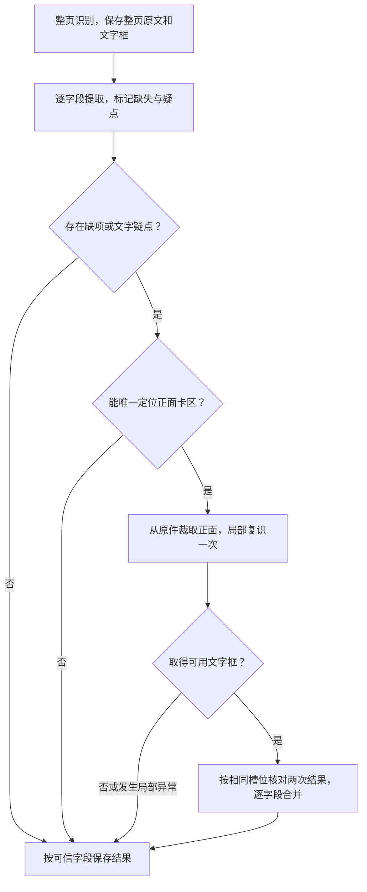

# 特种作业操作证 OCR 识别修复方案（修订稿）

本方案针对 [证件模板](../证件模板) 中的 5 张图片和 3 份单页 PDF。验收按原件逐字段比对，目标是 7 份样本各读对全部 7 项，低清截图至少恢复已证实可辨认的 3 项，8 份样本合计零错填。继续采用方案 A，归属或文字有疑问时留空。图片支持正立及带 EXIF 方向标记的输入，PDF 继续执行单页校验。[需求说明](../prd.md)

## 一、现有结果与实测依据

审查时，正式库中与当前 8 份原件匹配的成功记录共 56 项，**43 项正确、9 项缺失、4 项错填**。四项错填都是将“高处安装、维护、拆除作业”识别为“处安装、维护、拆除作业”。其中丁金城和丁三才的 PDF 各有七个非空字段。

下表每格表示与原件完全一致的字段数。对照使用当前模型和字段提取器，将全局长边上限从 2800 调至 4600、检测长边上限从 2400 调至 3200。后两列复用同一组检测框。黄伟平截图在这两列均先裁去上下纯色边、放大两倍。

| 样本 | 正式库正确数 | 新限长、原文字框 | 新限长、文字框补边 |
| --- | ---: | ---: | ---: |
| 模板1.png、模板2.jpg | 各 7/7 | 各 7/7 | 各 7/7 |
| 丁金城、丁三才两份 PDF | 各 6/7 | 各 6/7 | 各 7/7 |
| 苏志冲登高证 PDF | 5/7 | 6/7 | 7/7 |
| 黄锡强登高证、苏志冲电工证两张 JPG | 各 5/7 | 各 7/7 | 各 7/7 |
| 黄伟平.jpg | 2/7 | 2/7 | 2/7 |

黄伟平截图在正式库里读对了**性别、操作项目**，裁边放大后读对了**姓名、操作项目**。从原图人工框选正面，局部放大并补边后，现有提取器能同时读对**姓名、性别、操作项目**。人工框选是局部识别的对照实验，自动确定正面区域仍须端到端验证。

## 二、整页识别与坐标约定

1. **限长与补边。** 在正式配置中采用 `global_max_side_len=4600`、`det_limit_type="max"`、`det_limit_side_len=3200`。沿用检测、方向分类、文字识别顺序，只对送入识别器的文字图块补边。以图块高度 `h` 计算 `pad = max(4, min(10, round(0.12 * h)))`。灰度中位数至少为 128 时补白边，深底取外圈像素各通道的第 20 百分位。输出沿用检测四边形、原图坐标映射和现有置信度过滤。保留测试中注入轻量可调用引擎的入口。[配置](../config.py) · [识别引擎](../ocr_engine.py)
2. **裁边与小图放大。** 在灰度图上从四边扫描连续的低方差行列，标准差阈值取 2.5。裁去面积至少占原页 8%、且剩余宽高均不少于 200 像素时采用裁框。只裁去外边缘的连续空白，保留状态栏、页眉及背面中可读的文字。裁后长边小于 1500 或短边小于 950 像素时，双三次缩放倍率取 `max(1.0, min(2.0, 2600.0 / max(w, h)))`，其余取 1。这样 `3000 × 800` 的窄长图保持原尺寸。记录裁框左上角和取整后实际横纵倍率，按 `x / sx + left`、`y / sy + top` 还原为纠偏后的整页像素。
3. **单页 PDF 渲染。** 以 250 DPI 为基准。基准长边小于 2200 像素时，目标长边取 2400 像素，渲染倍率上限为每点 6 像素。超过 3200 像素的页面将长边限制到 3200 像素，其余沿用基准。当前三份 PDF 均为 `842 × 595` 点，在新旧方案中均渲染为 `2924 × 2066` 像素。这三份的实测改善来自识别路径，其他页面尺寸另行回归。
4. **局部区域接口。** `recognize_roi(file_ext, file_content, roi_box)` 接收纠偏后整页的像素框，返回同一坐标系中的 `TextBlock`。图片从 EXIF 纠偏后的原始像素裁取。PDF 保存整页渲染变换和像素原点，将四角反算成页面点、与可渲染区域求交，再交给 PyMuPDF 的 `clip`。局部结果经实际局部渲染变换还原为页面点，再映回整页像素。两次变换须计入页面旋转、裁剪框和渲染取整产生的原点偏移。局部区域按整页倍率计算的长边小于 1600 像素时，放大倍率取 `min(2.5, 1800.0 / 长边)`，PDF 可直接按相应倍率渲染。

坐标回归采用丁金城 PDF 的“高处安装、维护、拆除”首行。该行在页面中约为 `(323.6, 277.0, 398.6, 284.5)` 点，对应整页约 `(1124, 962, 1384, 988)` 像素。将整页像素直接传给 `clip` 得到空图，按页面点裁剪并以 250 DPI 渲染得到 `261 × 27` 像素。测试需核对实际裁出的文字及其回映位置。

## 三、正面定位与逐字段复核



**触发条件。** 整页提取后逐项记录字段所在槽位、对应文字框和疑点，供本次处理使用。字段缺失即尝试定位。对容易漏字的操作项目，将构成该值的文字行用原框复读，与补边结果比对，出现增删字即标疑。有可用 PDF 文字层时，可用同一正面槽位的文字核对，值冲突也标疑。七项都非空时仍执行这些检查。局部复识每份文件最多一次。[主流程](../main.py)

**正面定位。** `estimate_front_card_roi` 先沿用提取器对人像右侧、卡片底部的行列校验。标签、格式合法的证号、完整有效期和机关名都只能在位置相容时作为线索。至少两个不同槽位支持同一正面区域，才按该组的行高、行列间距扩展裁框，并裁到页面边界。排除卡外备注、页脚单位及背面标题。多个卡区无法区分、只剩孤立线索或裁框与整页等效时跳过局部识别。自动定位须覆盖待恢复的值行，包括折行的操作项目。[字段提取器](../field_extractor.py)

**合并规则。** 两阶段均使用现有标签或受限恢复规则校验字段，沿用日期、位置和折行校验。保留首次整页识别的 `raw_text`，局部复读产生的文字仅供字段判定。

| 同一字段的证据 | 最终处理 |
| --- | --- |
| 两次读数一致，槽位和字段校验通过 | 保存该值 |
| 只有一次取得值，归属明确且无未解决疑点 | 保存该次可信值 |
| 两个非空值冲突，或已有截字疑点 | 在同一槽位查找额外佐证，如原图局部复读与某一读数一致，或 PDF 同位置文字明确支持其中一个值。仍有歧义则留空 |
| 无可靠裁框、局部识别为空或局部推理异常 | 保留整页已确认的字段及原文，待定字段留空 |
| 最终没有可信字段 | 沿用现有失败状态，保留已取得的整页原文 |

字段总数只用于统计。局部识别多读出一项，不赋予其覆盖其他已确认值的优先权。合并两个冲突的候选时，用于裁决的佐证须能区分两者。重复引用产生候选的同一次读数不能算作额外佐证。

**异常行高的处理顺序。** 先收录苏志冲电工证的实际文字框，回放 `_confirm_region` 并断言最终性别和操作项目。若只剩高度 `36.8` 和 `105.6` 的两个标签，中位数为 `71.2`，按两倍中位数标异常会漏掉高框，两框高度比约 `2.87` 又会触发既有 `2.8` 守卫。前 7 份样本使用现有提取器已能达标。仅在回放能独立复现错误归属时调整分组，使用同区域其他正常行作参照，同时保留证据不足时留空的行为。

## 四、逐字段验收

下表为原件真值。仅供离线验证使用。每个输出按“正确、缺失、错填”之一计数。折行按同栏阅读顺序拼接，保留原标点。日期按既有规则规范化为 `YYYY-MM-DD`。

| 文件 | 姓名 | 性别 | 作业类别 | 操作项目 | 初领日期 | 签发机关 | 有效期截止日期 |
| --- | --- | --- | --- | --- | --- | --- | --- |
| 模板1.png | 廖浩庄 | 男 | 高处作业 | 高处安装、维护、拆除作业 | 2025-05-13 | 惠州市应急管理局 | 2031-05-12 |
| 模板2.jpg | 罗德财 | 男 | 高处作业 | 登高架设作业 | 2019-03-06 | 东莞市应急管理局 | 2028-08-28 |
| A44130044321008304苏志冲登高证.pdf | 苏志冲 | 男 | 高处作业 | 高处安装、维护、拆除作业 | 2018-08-08 | 惠州市应急管理局 | 2027-10-17 |
| A44130044324002185丁金城.pdf | 丁金城 | 男 | 高处作业 | 高处安装、维护、拆除作业 | 2024-01-30 | 惠州市应急管理局 | 2030-01-29 |
| A44530044325005774-丁三才-登高证.pdf | 丁三才 | 男 | 高处作业 | 高处安装、维护、拆除作业 | 2025-12-08 | 云浮市应急管理局 | 2031-12-07 |
| A44530044325005777-黄锡强-登高证_01.jpg | 黄锡强 | 男 | 高处作业 | 高处安装、维护、拆除作业 | 2025-12-08 | 云浮市应急管理局 | 2031-12-07 |
| A44530244322008484-苏志冲-电工证_01.jpg | 苏志冲 | 男 | 电工作业 | 低压电工作业 | 2022-12-21 | 云浮市应急管理局 | 2028-12-20 |
| 黄伟平.jpg | 黄伟平 | 男 | 高处作业 | 高处安装、维护、拆除作业 | 2023-12-08 | 惠州市应急管理局 | 2029-12-07 |

**通过条件。** 前七份的 49 项须全部正确。黄伟平截图通过自动定位至少读对姓名、性别和操作项目，另外四项仅在满足现有字段校验且有同槽位原文证据时接受，否则为 `None`。八份合计至少 52 项正确、零错填，正确、缺失、错填三项之和等于 56。运行时禁止使用样本文件名、人工坐标或真值表补字段。

**自动化回归。** 审查时现有 21 项测试全部通过。实施后通过 `uv run --with pytest pytest -v` 运行原有及新增用例。[提取器测试](../tests/test_field_extractor.py) · [流程测试](../tests/test_pipeline.py)

| 用例 | 必须核对的结果 |
| --- | --- |
| 七项非空但操作项目缺“高”，两阶段姓名或日期冲突 | 能触发复核，仅修订有同槽位佐证的字段，冲突无法裁决则留空 |
| 局部识别空结果、抛异常、纯背面或多个候选区域 | 保留整页已有可信值与原文，其他文件继续处理 |
| 黄伟平原图、加黑边或缩放的模板、带状态栏的截图 | 自动定位覆盖正面值行，对需要复识的样本检查实际触发记录，同时逐字段比对 |
| 浅底与深底文字框、窄长图、带 EXIF 的照片、不同页面尺寸及带旋转的 PDF | 核对补边颜色，以及裁边、缩放和局部渲染后文字框的原页位置 |
| 异常高框与正常框共存、只剩两个标签、粘连标签与值 | 断言最终字段内容，无独立证据时允许缺失 |

## 五、验证库与正式库切换

1. 每轮使用全新的独立验证库，从原始样本目录运行正式识别入口。同路径、同哈希的成功文件会被跳过，因此验证前应取得新的数据库路径。以下 PowerShell 命令在项目根目录运行。

   ```powershell
   $verifyDb = Join-Path './data' ('verify-' + [guid]::NewGuid().ToString('N') + '.db')
   uv run main.py --input './证件模板' --db $verifyDb
   ```

2. 验收脚本须显式接收本轮验证库路径，对照上表八份原件，核对路径、文件哈希及七个字段键。要求本轮 8 份重新处理、8 份成功、0 份跳过、0 份失败，实际比对 56 项。缺文件、重复记录、必达项缺失、任一错填或计数不符，验收均返回非零退出码。当前校验脚本只内置两张模板真值，实施时应补齐。[现有校验脚本](../debug/verify_results.py)
3. 验证库通过后，关闭相关 SQLite 写入和连接，备份正式库并核对备份可读。如启用 WAL，先将已提交内容完整纳入备份及待切换库。审查时旧库含 8 条成功与 2 条历史失败记录，重建会生成新的 `file_id`，历史记录和旧标识保留在备份中。
4. 在同一卷内将已通过验收的独立库安全替换为正式库。重新打开正式库，复核完整性、8 个文件哈希、56 项字段以及整页原文与新标识的关联。复核失败时恢复备份。通过后保留本轮验收结果与旧库备份。[持久化实现](../data_repository.py)
