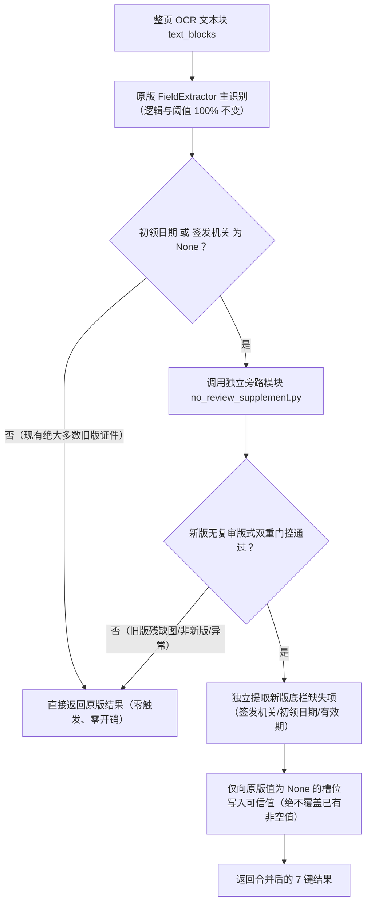

# 2026 新版“无复审”特种作业操作证识别缺项修订方案（解耦版）

本方案针对 [A44130032326012072谢鹏飞登高证.pdf](../证件模板/set2/A44130032326012072谢鹏飞登高证.pdf) 识别结果为 `5/7`（缺失 `初领日期`、`签发机关`）的问题，在**与原识别版本高度解耦、不改变原版主识别链路与既有几何阈值**的前提下，以独立后置补齐模块的方式解决新版“无复审”版式的字段缺项，确保对现有绝大多数正常识别的旧版证件实现**零侵入、零回退、零错填**。

---

## 一、问题现象与实测根因

### 1.1 实测现象

- 在 [ocr.db](../data/ocr.db) 中，`file_id=7024c642-d1ea-40a6-8e1b-da9efe90788c` 的识别结果为 `5/7`：
  - **已正确提取（5 项）**：`姓名=谢鹏飞`、`性别=男`、`作业类别=高处作业`、`操作项目=高处安装、维护、拆除作业`、`有效期截止日期=2032-09-19`。
  - **缺失（2 项）**：`初领日期=None`、`签发机关=None`。
- **OCR 本身无错漏**：整页 OCR 已以 `0.998~1.000` 的高置信度准确检出底部区域全部 6 个关键文本块（250 DPI 渲染尺寸 `2924 × 2066`）：

| 块序号 | 识别文本 | 像素坐标 (`x_min..x_max`, `y_min..y_max`, `h`) | 置信度 |
| ---: | --- | --- | ---: |
| 15 | `初领日期` | `x=653..725`, `y=1073..1094`, `h=21` | `0.998` |
| 16 | `有效期限` | `x=873..946`, `y=1071..1095`, `h=24` | `1.000` |
| 18 | `2026-09-20` | `x=655..791`, `y=1096..1122`, `h=26` | `1.000` |
| 19 | `2026-09-20至2032-09-19` | `x=857..1152`, `y=1096..1121`, `h=25` | `1.000` |
| 20 | `签发机关` | `x=653..725`, `y=1138..1162`, `h=24` | `0.998` |
| 21 | `惠州市应急管理局` | `x=655..865`, `y=1163..1193`, `h=30` | `0.999` |

### 1.2 新旧版式实测对比

对照同批 `set2` 中已全部 `7/7` 通过的 [44162319930920031X吴俊越.pdf](../证件模板/set2/44162319930920031X吴俊越.pdf) 与 [A44130044323510222-张嘉驹-登高证.pdf](../证件模板/set2/A44130044323510222-张嘉驹-登高证.pdf)，`set2` 其余 9 份均沿用旧版 2×2 底栏，唯独谢鹏飞的证书使用了 **2026 新版“无复审”底图**：

| 对比项 | 旧版底图（含“应复审日期”标签） | 2026 新版底图（谢鹏飞，取消复审） |
| --- | --- | --- |
| Row 1 左 / 右标签 | `初领日期` (`x=653`) / `有效期限` (`x=851~852`) | `初领日期` (`x=653`) / `有效期限` (`x=873`) |
| Row 1 有效期区间值 | `x=857..1152`（与标签左对齐） | `x=857..1152`（**较标签左偏 `16px ≈ 0.71h`**） |
| Row 2 左 / 右标签 | `应复审日期` (`x=654`) / `签发机关` (`x=852`) | **`签发机关` (`x=653`)** / *（空白）* |
| 签发机关值位置 | 右栏 `x=857..1066` | **左栏 `x=655..865`** |

### 1.3 三层失效链路

1. **根因 1（导致 `签发机关` 缺失）**：
   - [field_extractor.py](../field_extractor.py) 中 `_BOTTOM_SLOTS` 硬编码 `"签发机关": (2, 1)`（第二行右栏）。
   - 新版底图中 `签发机关` 位于 `初领日期` 正下方左栏 `(2, 0)`，在 `_confirm_region` → `_anchors_compatible` 校验时与 `初领日期 (1, 0)`（要求对角 `dx >= 2.2h`，实际 `dx=0`）和 `有效期限 (1, 1)`（要求同列左对齐，实际 `dx=-220`）均不兼容，被剔除出 `bottom_anchors`。
   - 退化至 `_recover_unlabeled_org` 后，仅在 `right_col_x = 873` 附近（`±1.8h = ±40.5px`）搜索机关名，而 `惠州市应急管理局` 在 `x=655`，最终置空。

2. **根因 2（导致 `初领日期` 缺失）**：
   - 新版底图中 `有效期限` 标签印在 `x=873`，而 PDF 填值仍从 `x=857.6` 起排（左偏 `16px ≈ 0.71 * label_h`）。
   - 在提取右栏 `有效期限` 时，左容差为 `1.2 * label_h`（对齐容差 `1.8 * label_h`），因此 `2026-09-20至2032-09-19` 正常归入右栏。
   - 但在提取左栏 `初领日期`（`col_right_limit=873, label_h=22.5`）时，右栏跳过阈值仅为 `col_right_limit - 0.35 * label_h = 865.125`。因 `857.0 < 865.125` 且 `1152.0 > 891.0`，块 `[19]` 被误判为左栏的 `crossing_blocks`（跨栏粘连块）；尽管与 `[18] '2026-09-20'`（`x=655..791`）之间有 `66px (2.93h)` 的清晰间隔，仍在行聚类后触发一票否决（`if any(id(b) in crossing_set for b in first_row_all): return None, []`），将 `初领日期` 置空。

3. **根因 3（次要原因：二阶段复核未补救并暴露 ROI 污染隐患）**：
   - 一阶段缺 2 项触发二阶段复核后，[two_stage_processor.py](../two_stage_processor.py) 的 `_estimate_front_card_roi` 使用 `known_values` 对整页文本做简单子串匹配。
   - `有效期截止日期='2032-09-19'` 误命中了卡外红色备注 `[23] '备注：本证书应于2032-09-19前进行换证。'`（`x=993..1912, y=1340..1386`），同时未纳入已检出的左下角标签 `初领日期`/`签发机关`（`x=653`）。
   - 估算出的 ROI 为 `(756.5, 807.0, 2012.5, 1453.0)`，左侧直接切掉了左下栏（仅剩 `'20'` 与 `'急管理局'`），右侧和下侧则吞入了背面卡片（国徽 `'★★'`、背面文字）与红色备注，导致二阶段无法补齐缺失项；且背面 `'★★'`（`y=860`）还高于正面 `'高处作业'`（`y=876.8`），导致二阶段连 `作业类别` 也返回 `None`（仅因一阶段已有值而未丢失）。

---

## 二、解耦设计原则与不修改边界

为避免因少数新版证书改动核心规则而破坏原有大多数样本的识别效果，本方案采用**“原版主链路零侵入 + 新版旁路只补空位”**的完全解耦架构。

### 2.1 严格的“五不改”边界

1. **不修改 [ocr_engine.py](../ocr_engine.py)**：检测/识别模型、限长、文字块补边、裁边缩放、PDF 渲染逻辑全部保持原样。
2. **不修改 [config.py](../config.py)**：固定七键、标签别名、OCR 参数常量全部保持原样。
3. **不修改 [field_extractor.py](../field_extractor.py) 原版识别算法与任何既有几何阈值**：`_BOTTOM_SLOTS`、`_anchors_compatible`、`_collect_labeled_field_value_with_blocks`（含 `0.35 * label_h`、`crossing_blocks` 判定）、`_recover_unlabeled_org` 等既有逻辑全部保持原样。
4. **不修改 [data_repository.py](../data_repository.py)、[file_scanner.py](../file_scanner.py)、[models.py](../models.py)、[main.py](../main.py)**：持久化结构、幂等策略与批处理编排保持原样。
5. **不覆盖原版已提取出的任何非空字段**：旁路模块严格执行**只补空位（Fill-Missing-Only）**原则，且具备独立异常捕获与开关回退能力。

### 2.2 解耦后的数据流架构



- 对 `set1` 全部、`set2` 其余 9 份、`模板1.png`、`模板2.jpg` 等原版已读出 `初领日期` 和 `签发机关` 的证件，流程在判断节点直接短路返回，**旁路模块连调用都不会进入**。
- 对 `A44130032326012072谢鹏飞登高证.pdf`，旁路模块在一阶段内存级（毫秒级、零额外 OCR）即可直接将 `5/7` 补齐为 `7/7`，从而自然跳过耗时且易出错的二阶段局部复识。

---

## 三、分阶段修订方案

### P0（核心必做）：新增独立旁路模块 `no_review_supplement.py`

新增独立文件 `no_review_supplement.py`，封装 2026 新版“无复审”底栏的版式门控与缺失字段补齐逻辑；仅在 [field_extractor.py](../field_extractor.py) 的 `FieldExtractor.extract_fields` 返回前挂载 3 行隔离钩子（带可关闭开关与异常静默回退）。

#### 1. 接入钩子（原文件最小化 3 行改动）

在 [field_extractor.py](../field_extractor.py) 的 `FieldExtractor.__init__` 增加可选参数 `enable_no_review_supplement: bool = True`（默认开启，便于 A/B 回归测试一键开关），在 `extract_fields` 末尾返回前执行：

```python
if (
    self._enable_no_review_supplement
    and (fields["初领日期"] is None or fields["签发机关"] is None)
):
    supplement_no_review_bottom_fields(text_blocks, fields)
```

- `supplement_no_review_bottom_fields` 内部以 `try/except` 兜底，任何未预期异常均静默放弃补齐，确保最坏情况下完全退回原版输出，绝不影响原有识别稳定性。
- 该函数先计算待补齐的局部字典，再仅对 `fields[key] is None` 的键赋值，从机制上杜绝覆盖原版已有非空字段的可能。

#### 2. 新版“无复审”版式双重门控（杜绝误伤旧版残缺图）

在 `no_review_supplement.py` 中独立定义新版三槽位底栏模板：

```python
_NO_REVIEW_BOTTOM_SLOTS = {
    "初领日期": (1, 0),
    "有效期截止日期": (1, 1),
    "签发机关": (2, 0),
}
```

门控同时要求满足以下两条，缺一不可：

1. **强正向门控**：使用无量纲相对几何（同列左对齐 `|dx| <= max(1.8h, 0.35 * max_w)`、同行/对角水平间距 `2.2h <= dx <= 22h`、上下行间距 `1.2h <= dy <= 7.5h`）在 `_NO_REVIEW_BOTTOM_SLOTS` 上确认出的锚点组中：
   - 至少包含 **2 个不同槽位**；
   - **必须明确包含 `签发机关 (row=2, col=0)` 标签锚点**（即已由几何关系独立证实 `签发机关` 位于 `初领日期` 正下方左对齐，或位于 `有效期限`/完整有效期区间左下方）。
2. **强负向守卫**：在同一底部区域的相容邻域内，**不得存在**与 Row 1 几何相容的 `应复审日期`/`复审日期` 标签锚点（若存在，说明该证件属于旧版 2×2 底栏，立即退出，绝不干预）。

> **零误触证明**：旧版证件无论清晰或残缺，其 `签发机关` 若存在必位于右栏 `(2, 1)`，与 `有效期限 (1, 1)` 水平偏移接近 `0`（不满足对角 `dx >= 2.2h`）、与 `初领日期 (1, 0)` 水平偏移远大于左对齐容差（不满足同列左对齐），因此永远无法通过强正向门控；无 `签发机关` 标签的压缩图/纯干扰图亦无法通过门控。

#### 3. 旁路独立字段补齐规则

门控通过后，按以下顺序仅对 `fields[key] is None` 的底部字段进行提取：

1. **先锁定右栏 `有效期截止日期` 块集合（供 `初领日期` 排障及极端漏项补齐）**：
   - 依据已确认的 `有效期截止日期 (1, 1)` 锚点，收集并解析完整有效期区间（复用合法日历校验与 `VALID_UNTIL_EXACT_LABELS` 单日期规则），记录其占用的 `block_indices`（记为 `validity_used_indices`）以及区间包围框 `confirmed_range_bbox`。
   - 若 `fields["有效期截止日期"] is None`（例如某新版证件因 `初领日期` 标签漏检导致原版未确认底部区域），则写入解析出的截止日期；若原版已有值，则不覆盖。
2. **补齐 `签发机关`**（仅当 `fields["签发机关"] is None`）：
   - 以已确认的 `签发机关 (2, 0)` 标签块为锚点，向下收集左对齐的机关名称（允许同栏左对齐换行续接，最多 2 行）。
   - 因新版底栏第二行右侧无其他字段，**不设置 `col_right_limit`**（兼容超过 8 个字的长机关名，如“广东省应急管理厅”“惠州市安全生产监督管理局”等向右越过 `valid.x` 的情况），但严格保留同行水平间距 `> 2.0 * label_h` 即截断的守卫，防止串入右侧二维码或背面卡文字。
   - 通过非噪声、非日期/证号、长度 `>= 4` 校验后，写入 `fields["签发机关"]`。
3. **补齐 `初领日期`**（仅当 `fields["初领日期"] is None`）：
   - **有 `初领日期 (1, 0)` 标签时**：
     - 垂直边界严格限定在 `初领日期` 标签下方、`签发机关 (2, 0)` 标签上方（`row1_y_limit = org_anchor.bbox.y - 0.1 * ref_h`）。
     - **消除新版标签右偏死区**：在左栏候选扫描时，直接跳过 `validity_used_indices` 中已明确归属 `有效期截止日期` 的文本块；同时对于起始位置在 `[right_col_x - 1.2 * label_h, right_col_x - 0.35 * label_h)` 且 `b.x > col_start_x + 1.8 * label_h` 的独立右栏块，若与同行左栏候选块之间水平间隔 `>= 0.8 * label_h`，判定其归属右栏并跳过。
     - **保留真跨栏粘连防御**：若某文本块起点位于左栏（`b.x < right_col_x - 1.2 * label_h`）却向右延伸超过 `right_col_x + 0.8 * label_h`（例如 OCR 将左右两栏误合并为单块），或与左栏候选粘连重叠，仍严格判定为跨栏歧义并留空。
     - 收集结果必须严格通过唯一合法单日期日历校验（`YYYY-MM-DD`），拒绝区间连接符与多日期混杂。
   - **`初领日期` 标签漏检但 `confirmed_range_bbox` 已确认时**：
     - 借助 `签发机关 (2, 0)` 提供的左列起点 `left_col_x`，在与 `confirmed_range_bbox` 同一视觉行、严格位于其左侧且左对齐于 `left_col_x` 的位置查找唯一合法单日期。

---

### P1（可选独立加固，不与 P0 强绑定）：二阶段 ROI 估算防噪声污染

> **说明**：实施 P0 后，`谢鹏飞登高证.pdf` 在一阶段即已达到 `7/7`，不再进入二阶段复核。P1 仅针对未来其他低清/缺项证件进入二阶段复核时的 ROI 裁切质量，**不影响一阶段原识别结果**，建议在 P0 验收通过后按需独立评估或分批合入。

- **改动范围**：仅限 [two_stage_processor.py](../two_stage_processor.py) 的 `_estimate_front_card_roi`。
- **最小修复点**：
  1. 在 `known_values` 子串匹配收集 `field_blocks` 前，先跳过噪声文本块（排除含 `备注`、`档案编码`、`监制`、`法律效力`、`主办单位`、`承办单位`、`备案号`、`mem.gov.cn` 等卡外关键词的块），根除卡外红色备注将 ROI 拉偏到背面卡片的问题。
  2. 在计算卡片包围框时，除已识别字段值块外，同时纳入位于已知值块邻域内的正面核心标签块（如 `初领日期`、`签发机关`），防止某栏值在一阶段缺失时被 ROI 裁掉。
  3. 仅当 P1 对现有低清回归样本（如 `黄伟平.jpg`）验证无任何下降时才合入。

---

## 四、零回归验收与测试计划

### 4.1 自动化单元测试

新建独立测试文件 `tests/test_no_review_supplement.py`（尽量不改动现有 [tests/test_field_extractor.py](../tests/test_field_extractor.py) 用例，保持原验收基准完整），覆盖以下场景：

| 测试用例 | 核对要点 |
| --- | --- |
| 谢鹏飞实测文本块全量提取 | `7/7` 全部准确（`初领日期=2026-09-20`、`签发机关=惠州市应急管理局`、其余 5 项与原版一致） |
| 平移与等比缩放不变性 | 对谢鹏飞实测文本块执行 `0.5× / 1.0× / 2.2×` 缩放与平移，输出均保持 `7/7` 一致 |
| 长名称签发机关跨列延伸 | 将 `惠州市应急管理局` 替换为 `广东省惠州市安全生产监督管理局`（`x_max` 明显越过 `有效期限.x`），仍准确完整提取且不触发跨栏误杀 |
| 真跨栏粘连防御 | 将 `初领日期` 与 `有效期限` 合并成单块 `'2026-09-20 2026-09-20至2032-09-19'`，`初领日期` 必须保持 `None`，零错填 |
| 旧版样本开关 A/B 零差异 | 对 `_template1_blocks`、`_template2_blocks`、`compressed_t1` 及所有旧版残缺用例分别对比 `enable_no_review_supplement=True/False`，输出字典 100% 完全一致 |
| 新版 `初领日期` 标签漏检恢复 | 移除新版 `初领日期` 标签，保留 `有效期限` 与 `签发机关 (2,0)`，仍可恢复 `2026-09-20`；再移除日期值块后返回 `None` |
| 旁路异常静默回退 | 模拟旁路补齐内部抛异常时，主流程不崩溃并完整保留原版 5/7 结果 |

### 4.2 全量回归命令（独立验证库，不污染正式库）

1. **自动化单测与集成测试**：
   ```powershell
   uv run --with pytest pytest -v
   ```
   要求原有 21 项及新增测试全部通过。

2. **样本集端到端独立库回归**：
   ```powershell
   $verifySet1 = Join-Path './data' ('verify-fix2-set1-' + [guid]::NewGuid().ToString('N') + '.db')
   uv run main.py --input './证件模板/set1' --db $verifySet1

   $verifySet2 = Join-Path './data' ('verify-fix2-set2-' + [guid]::NewGuid().ToString('N') + '.db')
   uv run main.py --input './证件模板/set2' --db $verifySet2
   ```

3. **通过标准**：
   - `证件模板/set1` 所有样本与修复前基准逐字段 100% 一致，无任何字段退化；
   - `证件模板/set2` 其余 9 份样本与原 [ocr.db](../data/ocr.db) 逐字段 100% 一致（全部 `7/7`）；
   - [A44130032326012072谢鹏飞登高证.pdf](../证件模板/set2/A44130032326012072谢鹏飞登高证.pdf) 从 `5/7` 提升为 **`7/7`**（`初领日期=2026-09-20`、`签发机关=惠州市应急管理局`），全样本合计**零错填**；
   - 确认全部通过后，再按需清理或重建正式库 `./data/ocr.db` 中该文件的历史记录以重新入库。
