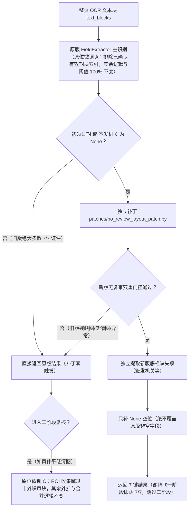

# 2026 新版“无复审”特种作业操作证识别缺项修订方案（微调 + 解耦补丁双轨版）

本方案针对 [A44130032326012072谢鹏飞登高证.pdf](../证件模板/set2/A44130032326012072谢鹏飞登高证.pdf) 识别结果为 `5/7`（缺失 `初领日期`、`签发机关`）的问题，严格遵循 [AGENTS.md](../AGENTS.md) 确立的工程准则：

> **能够在原识别逻辑上微调完成修复、且不影响原有识别效果的，直接在原逻辑上做精确微调；凡可能影响既有识别稳定性的版式/规则变更，严格与原识别逻辑解耦，以独立补丁形式修复。**

据此，本文先对每个根因与连带隐患逐项做稳定性风险评估，区分**“安全原位微调”**、**“独立解耦补丁”**与**“本次明确不改动”**三类边界，再给出完整实施方案与零回归验证计划。

---

## 一、问题现象与实测根因

### 1.1 实测现象

- 在 [ocr.db](../data/ocr.db) 中，`file_id=7024c642-d1ea-40a6-8e1b-da9efe90788c` 的识别结果为 `5/7`：
  - **已正确提取（5 项）**：`姓名=谢鹏飞`、`性别=男`、`作业类别=高处作业`、`操作项目=高处安装、维护、拆除作业`、`有效期截止日期=2032-09-19`。
  - **缺失（2 项）**：`初领日期=None`、`签发机关=None`。
- **OCR 本身无错漏**：整页 OCR 已以 `0.998~1.000` 的高置信度准确检出底部区域全部 6 个关键文本块（250 DPI 渲染尺寸 `2924 × 2066`）：

| 块序号 | 识别文本 | 像素坐标 (`x_min..x_max`, `y_min..y_max`, `h`) | 置信度 |
| ---: | --- | --- | ---: |
| 15 | `初领日期` | `x=653..725`, `y=1073..1094`, `h=21` | `0.998` |
| 16 | `有效期限` | `x=873..946`, `y=1071..1095`, `h=24` | `1.000` |
| 18 | `2026-09-20` | `x=655..791`, `y=1096..1122`, `h=26` | `1.000` |
| 19 | `2026-09-20至2032-09-19` | `x=857..1152`, `y=1096..1121`, `h=25` | `1.000` |
| 20 | `签发机关` | `x=653..725`, `y=1138..1162`, `h=24` | `0.998` |
| 21 | `惠州市应急管理局` | `x=655..865`, `y=1163..1193`, `h=30` | `0.999` |

### 1.2 新旧版式实测对比

对照同批 `set2` 中已全部 `7/7` 通过的 [44162319930920031X吴俊越.pdf](../证件模板/set2/44162319930920031X吴俊越.pdf) 与 [A44130044323510222-张嘉驹-登高证.pdf](../证件模板/set2/A44130044323510222-张嘉驹-登高证.pdf)，`set2` 其余 9 份（及 `set1` 全部 8 份）均沿用旧版 2×2 底栏，唯独谢鹏飞的证书使用了 **2026 新版“无复审”底图**：

| 对比项 | 旧版底图（含“应复审日期”标签） | 2026 新版底图（谢鹏飞，取消复审） |
| --- | --- | --- |
| Row 1 左 / 右标签 | `初领日期` (`x=653`) / `有效期限` (`x=851~852`) | `初领日期` (`x=653`) / `有效期限` (`x=873`) |
| Row 1 有效期区间值 | `x=857..1152`（与标签左对齐） | `x=857..1152`（**较标签左偏 `16px ≈ 0.71h`**） |
| Row 2 左 / 右标签 | `应复审日期` (`x=654`) / `签发机关` (`x=852`) | **`签发机关` (`x=653`)** / *（空白）* |
| 签发机关值位置 | 右栏 `x=857..1066` | **左栏 `x=655..865`** |

### 1.3 四项具体失效与隐患拆解

1. **子问题 A（导致 `初领日期` 缺失）**：
   - 新版底图中 `有效期限` 标签印在 `x=873`，而 PDF 填值仍从 `x=857.6` 起排（左偏 `16px ≈ 0.71 * label_h`）。
   - 提取右栏 `有效期限` 时左容差为 `1.2 * label_h`（对齐容差 `1.8 * label_h`），因此块 `[19] '2026-09-20至2032-09-19'` 已被成功识别为右栏值。
   - 但随后提取左栏 `初领日期`（`col_right_limit=873, label_h=22.5`）时，未排除已被右栏正式采纳的块 `[19]`，且右栏跳过阈值仅为 `col_right_limit - 0.35 * label_h = 865.125`。因 `857.0 < 865.125` 且 `1152.0 > 891.0`，块 `[19]` 被误标为 `crossing_blocks`，尽管与 `[18] '2026-09-20'`（`x=655..791`）存在 `66px (2.93h)` 清晰空白，仍在行聚类后触发一票否决，导致 `初领日期 = None`。
2. **子问题 B（导致 `签发机关` 缺失）**：
   - [field_extractor.py](../field_extractor.py) 的 `_BOTTOM_SLOTS` 硬编码 `"签发机关": (2, 1)`（第二行右栏）。
   - 新版底图删除了 `应复审日期`，将 `签发机关` 左移至 `初领日期` 正下方左栏 `(2, 0)`，在 `_confirm_region` 中与 `初领日期 (1, 0)`（要求对角 `dx >= 2.2h`，实际 `dx=0`）和 `有效期限 (1, 1)`（要求同列左对齐，实际 `dx=-220`）均不兼容而被剔除；退化至 `_recover_unlabeled_org` 后仅搜索右列 `x=873±40.5`，而 `惠州市应急管理局` 在 `x=655`，最终置空。
3. **子问题 C（二阶段 ROI 被卡外备注污染）**：
   - [two_stage_processor.py](../two_stage_processor.py) 的 `_estimate_front_card_roi` 使用 `known_values` 对整页文本块做子串匹配时，未排除卡外噪声块。`有效期截止日期='2032-09-19'` 误命中了卡外红色备注 `[23] '备注：本证书应于2032-09-19前进行换证。'`（`x=993..1912, y=1340..1386`），将 ROI 拉成 `(756.5, 807.0, 2012.5, 1453.0)`，切掉左下栏并吞入背面卡片。
4. **子问题 D（连带观察项：ROI 外扩公式重调 / 无右界最右栏被背面 `'★★'` 遮蔽）**：
   - 二阶段切歪后的 ROI 把背面国徽识别为 `'★★'`（`x=1896..1944, y=860..882`），因 `y=860` 略高于正面 `'高处作业'`（`y=876.8`），抢占了 `all_window_rows[0]`，导致二阶段连 `作业类别` 也返回 `None`（整页一阶段未出现该问题）。

---

## 二、逐项稳定性评估与“微调 vs 补丁”决策矩阵

基于 `set1`（7 份清晰件均 `7/7` + 低清截图 `黄伟平.jpg` `3/7`）与 `set2`（9 份旧版件均 `7/7`）的既有稳定基线，逐项判定改造方式：

| 子问题 | 改动候选 | 对原有识别稳定性影响评估 | 最终决策 | 决策依据 |
| --- | --- | --- | --- | --- |
| **子问题 A**：`初领日期` 被右栏已确认有效期块误杀 | 方案 A1：放宽全局 `0.35 * label_h` 跨栏阈值 | **有风险**：会影响 `姓名`、`性别`、`初领日期` 全部左栏的跨栏粘连防御，紧凑版面可能放过脏块 | **否决** | 禁止为了单一版式偏移放宽全局几何守卫 |
| **子问题 A**：`初领日期` 被右栏已确认有效期块误杀 | 方案 A2：在 `_extract_bottom_region` 中，将已通过严格校验归属 `有效期截止日期` 的块索引并入 `初领日期` 的排除集合 | **零影响、数学等价**：已确认的 `有效期截止日期` 块必满足 `_DATE_RANGE_RE.fullmatch`（或 `有效期至` 单日期），语义和物理上绝不可能是左栏块或左右粘连块；旧版样本中这些块原本就会在 `0.35h` 处被跳过，只是改由“已确认右栏归属”提前跳过，不改任何通用阈值 | **原位微调**（约 6~10 行） | 改动极小、零回归风险，且连带提升旧版轻微倾斜/偏移样本的鲁棒性 |
| **子问题 B**：新版 `签发机关` 移至 `(2, 0)` | 方案 B1：改造 `_BOTTOM_SLOTS`、`_confirm_region` 多版式竞争与 `_recover_unlabeled_org` | **有风险**：触及所有旧版清晰/低清/残缺件的底部主定位入口，新增槽位竞争分支与无标签双列搜索，可能影响旧版残缺件稳定性 | **否决** | 新版“无复审”属于新证照版式变体，不应侵入旧版核心定位模型 |
| **子问题 B**：新版 `签发机关` 移至 `(2, 0)` | 方案 B2：新增独立补丁模块 `patches/no_review_layout_patch.py`，在主提取末尾按需触发、双重门控、只补空位 | **零影响、物理隔离**：原版 `_BOTTOM_SLOTS` 与主定位逻辑一字不改；现有绝大多数旧版样本因已有 `签发机关` 连补丁入口都不进入；具备开关和异常静默回退 | **解耦补丁** | 严格隔离新版版式逻辑，完全保护原有主链路稳定性，便于后续扩展或下线 |
| **子问题 C**：`_estimate_front_card_roi` 被卡外备注命中 | 在子串匹配循环开头跳过 `_is_noise_text(block.text)` | **零影响、纯缺陷收敛**：`_is_noise_text` 仅过滤明确卡外页眉/背面/备注/页脚词，绝不会误滤正面字段值（含 `黄伟平.jpg` 已确认的姓名/操作项目）；7/7 正常件根本不走二阶段 | **原位微调**（2 行） | 属于明确代码缺陷修复，不改变任何 ROI 外扩参数 |
| **子问题 D**：重调 ROI 外扩系数 / 放宽最右栏 `all_window_rows[0]` 选行守卫 | 修改 `_estimate_front_card_roi` 框选公式或 `_collect_labeled_field_value_with_blocks` 跳行逻辑 | **有风险**：重调 ROI 外扩会直接影响 `黄伟平.jpg` 裁剪与放大倍率；无右界跳行选取可能在缺值件上引发跨行错填；且 A+B+C 修复后该问题在实测样本中已不再出现 | **本次不修改** | 避免过度设计动摇既有低清件与缺值件的保守防御 |

---

## 三、双轨架构数据流



**对 `A44130032326012072谢鹏飞登高证.pdf` 的协同效果**：
1. 主识别（含原位微调 A）直接将结果从 `5/7` 提升为 **`6/7`**（`初领日期='2026-09-20'` 在原主流程中干净提取）；
2. 因 `fields["签发机关"] is None` 触发独立补丁 B，经双重门控确认新版底栏后补齐 **`签发机关='惠州市应急管理局'`**，结果达到 **`7/7`**；
3. 一阶段即满 `7/7` 且无操作项目截字疑点，自然跳过耗时的二阶段局部 OCR。

---

## 四、详细实施方案

### 4.1 原位微调项（共 2 处，合计约 10 行，零阈值变更）

#### 微调 1：[field_extractor.py](../field_extractor.py) `_extract_bottom_region` 排除已确认归属 `有效期截止日期` 的块索引

- **改动位置**：[field_extractor.py](../field_extractor.py#L858-L929)（不改 `_collect_labeled_field_value_with_blocks` 签名及内部任何阈值）。
- **具体做法**：
  1. 在 `_extract_bottom_region` 开头定义 `validity_block_indices: Set[int] = set()`。
  2. 解析 `有效期截止日期` 的三条成功分支时，同步记录已被正式采纳的文本块索引：
     - 有标签分支（`range_parsed is not None` 或 `matched_alias in VALID_UNTIL_EXACT_LABELS` 且 `single_iso is not None`）：按 `used_ids = {id(b) for b in used_blocks}` 映射回 `text_blocks` 索引并加入 `validity_block_indices`；
     - `validity_anchor.range_evidence is not None` 分支：加入 `validity_anchor.range_evidence.block_indices`；
     - `_find_range_in_row1_right` 命中分支：加入 `matched_ev.block_indices`。
  3. 紧接着提取 `初领日期` 时，构造 `first_excluded_indices = label_block_indices | validity_block_indices`，分别传给 `_collect_labeled_field_value` 与 `_recover_unlabeled_first_issue_date` 的 `label_block_indices` 参数。
- **安全性保证**：
  - 只有通过严格 `fullmatch` 的纯有效期区间或明确 `有效期至` 下的纯单日期块才会进入 `validity_block_indices`；
  - 若 OCR 将 `初领日期` 与 `有效期限` 粘连成单个跨栏块（如 `'2026-09-20 2026-09-20至2032-09-19'`），该块含 3 个日期，无法通过 `fullmatch`，因此不会进入 `validity_block_indices`，依然会照常触发 `crossing_blocks` 一票否决并返回 `None`。

#### 微调 2：[two_stage_processor.py](../two_stage_processor.py) `_estimate_front_card_roi` 过滤卡外噪声块

- **改动位置**：[two_stage_processor.py](../two_stage_processor.py#L120-L127)。
- **具体做法**：
  - 从 `field_extractor` 复用 `_is_noise_text`（或暴露的只读判断函数 `is_noise_text`），在匹配 `known_values` 前跳过卡外干扰块：
    ```python
    for block in text_blocks:
        if _is_noise_text(block.text):
            continue
        for val in known_values:
            ...
    ```
- **安全性保证**：不修改 `expand_x`、`expand_y`、尺寸校验及合并逻辑，仅剔除 `备注/档案编码/监制/法律效力/主办单位` 等绝不可能属于正面字段值的卡外文本块，保证 `黄伟平.jpg` 等低清截图的既有 `3/7` 表现不受影响。

---

### 4.2 解耦补丁项（1 处独立补丁模块）

新建 `patches/` 补丁目录（`patches/__init__.py`、`patches/no_review_layout_patch.py`），专门承接 **2026 新版“无复审”底栏（`签发机关` 左移至 `(2, 0)`）** 的后置补齐。

#### 1. 极简隔离钩子（[field_extractor.py](../field_extractor.py) 末尾 3 行）

在 `FieldExtractor.__init__` 增加可选参数 `enable_patches: bool = True`（默认开启，便于 A/B 对比测试一键开关），在 `FieldExtractor.extract_fields` 返回前挂载：

```python
if (
    self._enable_patches
    and (fields["签发机关"] is None or fields["初领日期"] is None)
):
    apply_no_review_layout_patch(text_blocks, fields)
```

- 补丁函数内部自带 `try/except` 静默兜底：任何未预期异常均直接放弃补齐，原样保留原版识别结果。
- 补丁函数严格执行**只补空位（Fill-Missing-Only）**：先在局部字典中计算待补字段，仅当 `fields[key] is None` 时写入，绝不覆盖原版已有非空字段。
- 只要未来不再需要该补丁或需要替换，删除 `patches/no_review_layout_patch.py` 与此 3 行调用即可 100% 恢复原版代码。

#### 2. 新版“无复审”版式双重门控（确保旧版零误触）

在 `patches/no_review_layout_patch.py` 中独立定义新版三槽位底栏模板：

```python
_NO_REVIEW_BOTTOM_SLOTS = {
    "初领日期": (1, 0),
    "有效期截止日期": (1, 1),
    "签发机关": (2, 0),
}
```

同时满足以下两个条件才激活补齐，缺一不可：

1. **强正向门控**：使用无量纲相对几何在 `_NO_REVIEW_BOTTOM_SLOTS` 上确认出的最优锚点组必须：
   - 包含至少 **2 个不同槽位**；
   - **必须明确包含 `签发机关 (row=2, col=0)` 标签锚点**（即经几何校验独立证实 `签发机关` 位于 `初领日期` 正下方左对齐，或位于 `有效期限`/完整有效期区间左下方）。
2. **强负向守卫**：在同一底部区域的相容邻域内，**不得存在**与 Row 1 几何相容的 `应复审日期`/`复审日期` 标签锚点（若存在则说明属旧版 2×2 底栏，立即退出）。

> **零误触说明**：旧版证件（含残缺图、低清图）中的 `签发机关` 位于右栏 `(2, 1)`，与 `有效期限 (1, 1)` 水平偏移接近 `0`、与 `初领日期 (1, 0)` 水平偏移远超左对齐容差，几何上不可能通过 `(2, 0)` 校验；无 `签发机关` 标签的压缩图/干扰图亦被正向门控拦截。

#### 3. 补丁内部字段补齐逻辑

门控通过后，仅对原版仍为 `None` 的底部字段执行独立补齐：

1. **核心目标——补齐 `签发机关`**（`fields["签发机关"] is None`）：
   - 以已确认的 `签发机关 (2, 0)` 标签块为起点，向下收集左对齐的机关名称（允许同栏左对齐换行续接，最多 2 行）。
   - 因新版底栏第二行右侧无其他字段，**不设置 `col_right_limit`**，确保超 8 字的长机关名（如“广东省惠州市安全生产监督管理局”）向右跨过 `有效期限.x` 时仍能完整提取；同时保留同行水平间隔 `> 2.0 * label_h` 即截断的守卫，防止串入二维码或背面卡。
   - 经机关合法性校验（非噪声、非日期/证号、长度 `>= 4`）后写入。
2. **协同兜底——补齐 `有效期截止日期` / `初领日期`**（仅当极端场景下新版证因 `初领日期` 标签漏检导致原版未确认底部区域、两者仍为 `None` 时）：
   - 先解析右栏 `有效期截止日期 (1, 1)`，记录其 `validity_block_indices` 与 `confirmed_range_bbox`，若原版为 `None` 则补齐；
   - 若 `fields["初领日期"] is None`：有 `初领日期 (1, 0)` 标签时在 `签发机关 (2, 0)` 上方且排除 `validity_block_indices` 后收集单日期；标签漏检但 `confirmed_range_bbox` 已确认时，借 `签发机关 (2, 0)` 提供的左列起点 `left_col_x` 在有效期区间同排左侧提取唯一合法单日期。

---

### 4.3 明确不改动边界

以下模块与核心逻辑本次**完全不修改**，确保既有识别基线稳定：

- [ocr_engine.py](../ocr_engine.py)、[config.py](../config.py)、[data_repository.py](../data_repository.py)、[file_scanner.py](../file_scanner.py)、[models.py](../models.py)、[main.py](../main.py)；
- [field_extractor.py](../field_extractor.py) 中的 `_BOTTOM_SLOTS`、`_confirm_region`、`_anchors_compatible`、`_collect_labeled_field_value_with_blocks`（含 `0.35 * label_h` 跨栏判定与 `all_window_rows[0]` 选行守卫）、`_recover_unlabeled_org`；
- [two_stage_processor.py](../two_stage_processor.py) 中的 `expand_x / expand_y` 外扩倍率与 `_merge_fields` 合并策略。

---

## 五、零回归验收与测试计划

### 5.1 自动化单元测试

在尽量不改动既有 [tests/test_field_extractor.py](../tests/test_field_extractor.py) 用例的前提下，新增独立测试文件 `tests/test_no_review_patch.py`，分别覆盖原位微调与解耦补丁：

| 类别 | 测试用例 | 核对要点 |
| --- | --- | --- |
| 微调 1 验证 | 右栏已确认有效期块微左偏（`0.7h`） | 关闭补丁（`enable_patches=False`）时，`谢鹏飞` 实测文本块仍能正确提取 `初领日期=2026-09-20`（6/7），证明微调 1 独立生效 |
| 微调 1 防御 | `初领日期` 与 `有效期限` 真跨栏合并单块 | 合并为 `'2026-09-20 2026-09-20至2032-09-19'` 时，两者均不误填，`初领日期` 保持 `None` |
| 微调 2 验证 | `_estimate_front_card_roi` 噪声过滤 | 构造含红色备注且备注含 `有效期截止日期` 字符串的文本块，ROI 边界不得被备注拉偏至背面或页底 |
| 补丁核心验证 | 谢鹏飞实测文本块完整提取 | 开启补丁后 `7/7` 全部准确（`初领日期=2026-09-20`、`签发机关=惠州市应急管理局`） |
| 补丁不变性 | 平移与 `0.5× / 1.0× / 2.2×` 缩放 | 所有变换后均保持 `7/7` 一致 |
| 补丁边界 | 超长签发机关名跨越 `有效期限.x` | 替换为 `'广东省惠州市安全生产监督管理局'` 时仍完整准确提取，不触发跨栏误杀 |
| 补丁兜底 | 新版 `初领日期` 标签漏检 | 仅保留 `有效期限` + `签发机关 (2,0)` 时仍可恢复 `2026-09-20`；再删日期值块后为 `None` |
| 零回归 A/B | 旧版样本开关对比 | 对 `_template1_blocks`、`_template2_blocks`、`compressed_t1` 及旧版残缺用例对比 `enable_patches=True/False`，输出 100% 字节级一致 |
| 异常隔离 | 补丁内部模拟抛异常 | 主流程不崩溃，完整保留原版结果（对谢鹏飞保留 `6/7`） |

### 5.2 端到端独立库全量回归命令

1. **运行全部单元测试与集成测试**：
   ```powershell
   uv run --with pytest pytest -v
   ```
   要求原有 21 项及新增测试全部通过。

2. **使用全新独立验证库回归 `set1` 与 `set2` 全量样本**：
   ```powershell
   $verifySet1 = Join-Path './data' ('verify-fix2-set1-' + [guid]::NewGuid().ToString('N') + '.db')
   uv run main.py --input './证件模板/set1' --db $verifySet1

   $verifySet2 = Join-Path './data' ('verify-fix2-set2-' + [guid]::NewGuid().ToString('N') + '.db')
   uv run main.py --input './证件模板/set2' --db $verifySet2
   ```

3. **验收通过标准**：
   - `证件模板/set1`：7 份清晰件全部 `7/7`，`黄伟平.jpg` 保持至少 `3/7`（`姓名/性别/操作项目` 准确，无退化），8 份合计零错填；
   - `证件模板/set2`：原有 9 份旧版件与原 [ocr.db](../data/ocr.db) 逐字段 100% 一致（全部 `7/7`）；
   - [A44130032326012072谢鹏飞登高证.pdf](../证件模板/set2/A44130032326012072谢鹏飞登高证.pdf) 从 `5/7` 提升为 **`7/7`**（`初领日期=2026-09-20`、`签发机关=惠州市应急管理局`），10 份合计 **70/70 准确、零错填**；
   - 独立验证库全部验收通过后，再按需清理或重建正式库 `./data/ocr.db` 中谢鹏飞的旧记录以重新入库。
