# 特种作业操作证 OCR 系统 — 模块设计方案（V3.0）

**项目阶段**　增量架构设计（整合既有七字段实现、两阶段复核、2026 新版无复审补丁，以及 FR-04 / FR-05 增量需求）

**文档状态**　架构审查修订稿（已对齐全部代码库现状与 `prd1.md` 增量需求，待按本文实施编码与验收）

**需求依据**　[需求分析说明书 V1.1](../prd/prd(已完成).md) · [证号、联合主键与有效期开始日期增量需求](../prd/prd1.md)

**工程准则**　最小化设计、准确度优先（错填为零）、文件可追溯、单文件异常隔离；能原位微调且不影响既有稳定性的直接微调，可能影响既有稳定性的严格解耦为独立补丁。

---

## 一、设计背景与核心问题分析

### 1.1 任务边界

处理指定文件夹当前层的 PNG、JPG/JPEG 和单页 PDF，目标证件为**中华人民共和国特种作业操作证**。每份文件保留在原位置，可按 `file_id` 查回源文件路径、处理状态、整页 OCR 原文和固定九个结构化字段；当“证号”与“作业类别”均确定时，按联合主键 `(证号, 作业类别)` 归并或建立唯一证件记录，并关联对应的源文件 `file_id`，支持同号异类独立建档与同号同类多文件追溯。失败或不支持记录不建立证件关联，失败记录保留已取得的原文。

### 1.2 目标证件真实版面差异与共性

系统覆盖横版打印页（含旧版 2×2 底栏及 2026 新版无复审三槽位底栏）和竖版手机查询页。[横版原图](../证件模板/set1/模板1.png) · [竖版原图](../证件模板/set1/模板2.jpg) · [2026 新版无复审样本](../证件模板/set2/A44130032326012072谢鹏飞登高证.pdf)

| 对比维度 | `模板1.png`（官网导出横版打印页） | `模板2.jpg`（手机查询页竖版截图） | 2026 新版“无复审”横版（如谢鹏飞证） |
|---|---|---|---|
| **分辨率与排布** | `1679 × 1127` px，正反卡**左右并排** | `1240 × 2772` px，正反卡**上下堆叠** | PDF 250 DPI 约 `2924 × 2066` px，正反卡左右并排 |
| **正面卡占比与字号** | 卡片约 `470 × 300` px，标签高 `9~11` px | 卡片约 `1050 × 600` px，标签高约 `22` px | 卡片结构同横版，底栏无“应复审日期” |
| **证号区特征** | 位于人像右侧最顶部，**通栏宽度**，右端常越过 `作业类别` 列起点 | 同为顶部通栏，右端同样越过 `作业类别` 列起点 | 与旧版一致，顶部通栏 |
| **底栏排布差异** | 2×2 底栏：`初领日期`/`有效期限`；`应复审日期`/`签发机关` | 2×2 底栏，同左侧横版 | 三槽位底栏：取消`应复审日期`，`签发机关`左移至 `(2, 0)`；`有效期限`值块较标签左偏约 `0.71h` |
| **主要干扰源** | 页眉 `档案编码：A...`、右侧背面、复审备注、页底声明 | 手机状态栏、有效/无效页签、下方背面、复审备注、主办/承办单位、备案号 | 同横版打印页，卡外备注常含换证截止日期 |

正面卡内核心槽位几何关系（主识别模型）：

| 正面卡内区域 | 第 0 行（通栏） | 第一行左 / 右 | 第二行左 / 右 |
|---|---|---|---|
| **人像右侧（上半区）** | `证号` `(0, 0)`（无右栏列界） | `姓名` `(1, 0)` / `作业类别` `(1, 1)` | `性别` `(2, 0)` / `操作项目` `(2, 1)` |
| **卡片底部（旧版 2×2）** | — | `初领日期` `(1, 0)` / `有效期限` `(1, 1)` | `应复审日期` `(2, 0)` / `签发机关` `(2, 1)` |
| **卡片底部（新版无复审补丁）** | — | `初领日期` `(1, 0)` / `有效期限` `(1, 1)` | `签发机关` `(2, 0)` / *（空白，无右界）* |

> **关键设计约束**：
> 1. **证号通栏性**：实测两张模板中，证号值右边界（模板 1 为 `708 > 648`，模板 2 为 `778 > 760`）均跨越了第一行右栏 `作业类别` 的起点 `right_col_x`。因此提取 `证号` 时**禁止**施加 `right_col_x` 作为右列边界，仅依赖同行连续间隔守卫（`> 2.0 * label_h` 截断）与纵向底界（`row1_label_y`）隔离右侧背面卡与下方字段。
> 2. **有效期双端点分离**：底栏 `(1, 1)` 的物理标签（`有效期限` / `有效期` / `有效期至`）映射到一个**逻辑槽位**，经统一端点解析器同时产出 `有效期开始日期` 与 `有效期截止日期` 两个独立标准字段，避免与标签映射表产生键冲突。

### 1.3 增量需求稳定性评估（微调 vs 解耦边界矩阵）

严格遵循 `AGENTS.md` 准则，逐项评估 FR-04、FR-05 及关联改动对既有 7 字段基线（`set1` + `set2`）的稳定性影响：

| 变更点 | 变更方式 | 对既有 7 字段识别稳定性的影响分析 | 决策 |
|---|---|---|---|
| **FR-04 证号提取** | 原位微调 `field_extractor.py` | 复用已有 `_UPPER_SLOTS["证号"]=(0,0)` 与 `_find_cert_no_anchors`；不改 `_confirm_region` 与 `_anchors_compatible`；无标签锚点维持严格 `^T\d{17}[\dXx]$`，仅在有“证号”标签时放宽文本编号校验（保留字母与前导零） | **安全原位微调** |
| **FR-05 有效期双端点解析** | 保留 `_parse_date_range` 不变，新增 `_parse_validity_endpoints` | `_find_date_range_evidences`（区域锚点证据 & 初领日期无标签恢复基准框）继续使用严格完整区间校验，保证零错填稳定性不受半残缺区间影响；仅在已确认标签栏位内启用独立端点解析 | **逻辑隔离微调** |
| **FR-05 有效期块排除集** | 微调 `_extract_bottom_region` | 有标签下只要解析出起日或止日任一端点，即将所采纳块并入 `validity_block_indices`，保障半残缺区间在新版微左偏版式下也不误杀 `初领日期` | **安全原位微调** |
| **FR-05 同步至新版无复审补丁** | 更新 `patches/no_review_layout_patch.py` | 补丁与主提取器物理隔离，升级其有效期辅助提取同时补齐起/止两日，仍严守双重门控与只补空位（Fill-Missing-Only） | **解耦补丁同步** |
| **FR-05 与两阶段复核协作** | 微调 `two_stage_processor.py` | 当仅缺失 `有效期开始日期` 且已由明确 `有效期至` 标签确定 `有效期截止日期` 时，免于无谓触发二阶段局部 OCR；两阶段合并后追加起止日期逻辑一致性校验（`start <= end`） | **安全原位微调** |
| **FR-04 联合主键持久化** | 新增 `certificates` 与 `certificate_files` 两表 | **零侵入**存量 `files` 与 `extracted_fields` 表结构及旧库迁移逻辑，完全向后兼容历史 7 字段库，数据库层原生强制联合主键与外键约束 | **增量扩展表** |
| **明确不动边界** | — | `file_scanner.py`、`ocr_engine.py` 核心推理与裁边缩放补边参数、`_UPPER_SLOTS`/`_BOTTOM_SLOTS` 相对网格坐标、`_confirm_region`、`_anchors_compatible`、跨栏阈值 `0.35 * label_h`、`expand_x / expand_y` 均不改动 | **冻结保护** |

---

## 二、总体架构与模块划分

### 2.1 端到端数据流架构

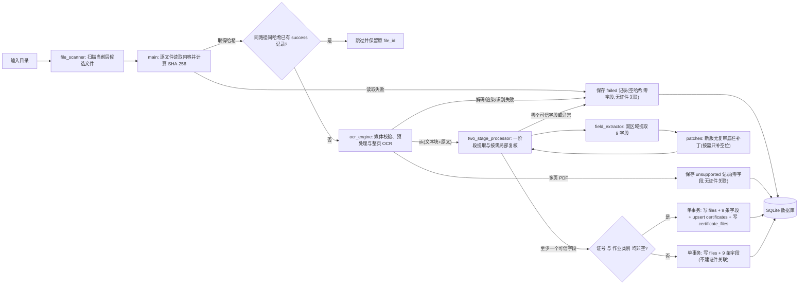

### 2.2 模块依赖关系（无环 DAG）

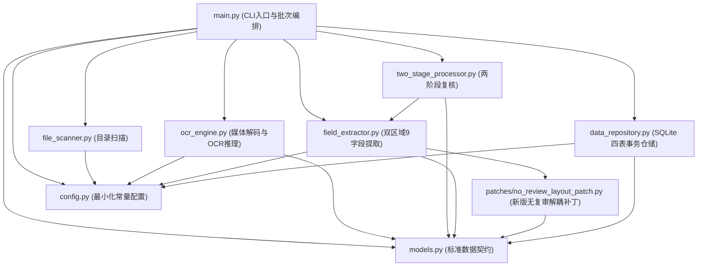

---

## 三、各模块详细设计（含流程图与伪代码）

### 3.1 最小化配置模块（`config.py`）

集中保存扩展名白名单、PDF 渲染 DPI、正式/快速双档数据库路径与 OCR 参数、固定九个标准输出键及标签别名映射。几何匹配规则属于提取器内部算法，不进入配置。

#### 核心字段与标签契约（9 字段）

| 标准输出键（`FIELD_KEYS`） | 版面逻辑槽位 | 可识别标签别名 | 字段取值与格式规则 |
|---|---|---|---|
| `证号` | `证号` `(0,0)` | `证号` | 按文本保存完整号码，去空白，**保留字母和前导零**；无标签仅认 `^T\d{17}[\dXx]$`，有标签允许通用字母数字编号，排除页眉 `档案编码`。 |
| `姓名` | `姓名` `(1,0)` | `姓名` | 本栏中文姓名，允许间隔号（`·`/`•`/`・`）。 |
| `性别` | `性别` `(2,0)` | `性别` | 仅接受单个“男”或“女”。 |
| `作业类别` | `作业类别` `(1,1)` | `作业类别`、`作业类型` | 本栏完整作业类别名称（如 `电工作业`、`高处作业`）。 |
| `操作项目` | `操作项目` `(2,1)` | `操作项目`、`操作类型` | 可接续同栏紧邻左对齐下一行，保留原有标点。 |
| `初领日期` | `初领日期` `(1,0)` | `初领日期`、`初次领取日期`、`初领目期` | 底部第一行左栏单个合法日历日期，`YYYY-MM-DD`。 |
| `有效期开始日期` | 共享 `有效期限` `(1,1)` | 见下方 `VALIDITY_LABEL_ALIASES` | 有效期限起日，`YYYY-MM-DD`，须独立确定，无法确定记为 `None`。 |
| `有效期截止日期` | 共享 `有效期限` `(1,1)` | 见下方 `VALIDITY_LABEL_ALIASES` | 有效期限止日，`YYYY-MM-DD`，须独立确定，无法确定记为 `None`。 |
| `签发机关` | `签发机关` `(2,1)` / 新版 `(2,0)` | `签发机关`、`发证机关` | 本栏完整机构名称，允许换行续接。 |

- **有效期限槽位标签（防双键冲突）**：在 `config.py` 中用独立常量 `VALIDITY_SLOT_KEY = "有效期限"` 与 `SLOT_LABEL_ALIASES`（或保持 `FIELD_LABEL_ALIASES` 不重复绑定两键，将 `"有效期限" / "有效期" / "有效期至"` 统一映射到逻辑槽位 `"有效期限"`，由提取器同时填充 `有效期开始日期` 与 `有效期截止日期`）。
- **明确单止日标签**：`VALID_UNTIL_EXACT_LABELS = frozenset({"有效期至"})`。
- **纯辅助定位标签**：`AUX_LABEL_ALIASES = {"应复审日期": ("应复审日期", "复审日期")}`（`证号` 已升格为正式输出字段，不再属于纯辅助键）。
- **数据库路径隔离**：正式默认 `./data/ocr.db`，快速联调默认 `./data/ocr_fast.db`。

#### 流程图

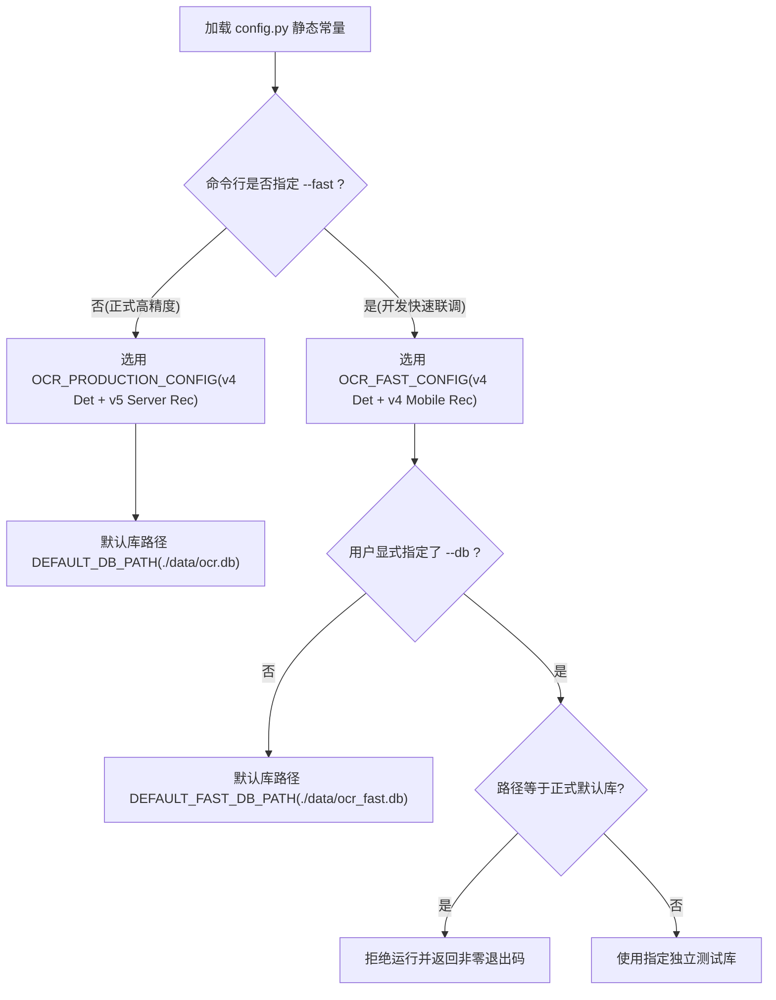

#### 伪代码

```text
常量 SUPPORTED_EXTENSIONS = {".pdf", ".png", ".jpg", ".jpeg"}
常量 PDF_RENDER_DPI = 250
常量 DEFAULT_DB_PATH = "./data/ocr.db"
常量 DEFAULT_FAST_DB_PATH = "./data/ocr_fast.db"

常量 FIELD_KEYS = (
    "证号", "姓名", "性别", "作业类别", "操作项目",
    "初领日期", "有效期开始日期", "有效期截止日期", "签发机关"
)

常量 VALIDITY_SLOT_KEY = "有效期限"

常量 SLOT_LABEL_ALIASES = {
    "证号": ("证号",),
    "姓名": ("姓名",),
    "性别": ("性别",),
    "作业类别": ("作业类别", "作业类型"),
    "操作项目": ("操作项目", "操作类型"),
    "初领日期": ("初领日期", "初次领取日期", "初领目期"),
    "有效期限": ("有效期限", "有效期", "有效期至"),
    "签发机关": ("签发机关", "发证机关"),
}

常量 AUX_LABEL_ALIASES = {
    "应复审日期": ("应复审日期", "复审日期"),
}

常量 VALID_UNTIL_EXACT_LABELS = {"有效期至"}

常量 OCR_PRODUCTION_CONFIG = {
    engine_type="onnxruntime", det="ch_PP-OCRv4_mobile", rec="ch_PP-OCRv5_server",
    global_max_side_len=4600, det_limit_type="max", det_limit_side_len=3200
}
常量 OCR_FAST_CONFIG = 覆盖 OCR_PRODUCTION_CONFIG 的 rec 为 "ch_PP-OCRv4_mobile"
```

---

### 3.2 数据契约模块（`models.py`）

定义跨模块流转的标准 `dataclass` 与无第三方依赖的辅助函数，支撑九字段字典与证件归并视图。

#### 数据契约清单

| 契约类型 | 核心字段与使用边界 |
|---|---|
| `FieldDict` | `Dict[str, Optional[str]]`，新提取结果固定包含 9 个标准键，值均为文本或 `None`。 |
| `CertificateKey` | `Tuple[str, str]`，即 `(cert_no, work_category)`，两项均须为非空非空白字符串。 |
| `FileInfo` | `file_name`、规范化绝对路径 `file_path`、小写 `file_ext`、可空 SHA-256 `file_hash`（仅读取失败时为 `None`）。 |
| `TextBlock` | `text`、`confidence`、`x`、`y`、`width`、`height` 及衍生属性 `x_max`/`y_max`/`x_center`/`y_center`，坐标统一映射回纠偏后整页图像左上角原点。 |
| `OCRResult` | `status`（`ok`/`unsupported`/`failed`）、`text_blocks`、`image_width`、`image_height`、`raw_text`、`error_message`。 |
| `ProcessResult` | 按 `file_id` 查询返回：`file_id`、`file_info`、`status`、`raw_text`、`fields`、`error_message`、`created_at`、**新增 `certificate_key: Optional[CertificateKey] = None`**。 |
| `CertificateRecord` | **新增**：按联合主键查询返回：`cert_no`、`work_category`、`file_ids: List[str]`、`created_at`、`updated_at`。 |

#### 流程图（契约组装与校验流转）

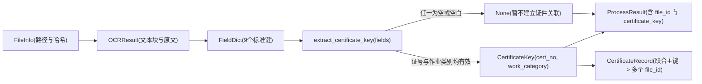

#### 伪代码

```text
类型 FieldDict = Dict[str, Optional[str]]
类型 CertificateKey = Tuple[str, str]

函数 create_empty_fields() -> FieldDict:
    返回 {key: None 对每个 key 属于 FIELD_KEYS}

函数 count_non_empty_fields(fields: FieldDict) -> int:
    返回 统计 FIELD_KEYS 中满足 fields.get(key) 非 None 且去空白非空的数量

函数 extract_certificate_key(fields: FieldDict) -> Optional[CertificateKey]:
    cert_no = fields.get("证号")
    work_cat = fields.get("作业类别")
    若 cert_no 为 None 或 work_cat 为 None:
        返回 None
    cert_no_clean = cert_no.strip()
    work_cat_clean = work_cat.strip()
    若 cert_no_clean == "" 或 work_cat_clean == "":
        返回 None
    返回 (cert_no_clean, work_cat_clean)

数据类 ProcessResult:
    file_id: str
    file_info: FileInfo
    status: FileStatus
    raw_text: Optional[str] = None
    fields: FieldDict = {}
    error_message: Optional[str] = None
    created_at: Optional[str] = None
    certificate_key: Optional[CertificateKey] = None

数据类 CertificateRecord:
    cert_no: str
    work_category: str
    file_ids: List[str]
    created_at: str
    updated_at: str
```

---

### 3.3 文件扫描模块（`file_scanner.py`）

零第三方依赖，仅枚举目标目录当前层级，按小写扩展名筛选支持格式并按文件名排序，不读取文件内容。

#### 流程图

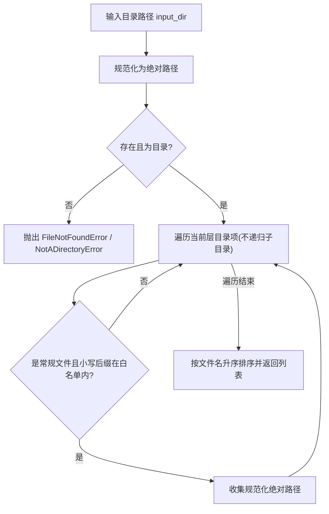

#### 伪代码

```text
函数 scan_folder(input_dir: str) -> List[str]:
    input_path = Path(input_dir).resolve()
    若 input_path 不存在: 抛出 FileNotFoundError
    若 input_path 非目录: 抛出 NotADirectoryError

    candidates = []
    遍历 entry 属于 input_path.iterdir():
        若 entry 非普通文件: 跳过
        若 entry.suffix.lower() 不在 SUPPORTED_EXTENSIONS: 跳过
        candidates.append(str(entry.resolve()))

    按文件名 os.path.basename 升序排序 candidates
    返回 candidates
```

---

### 3.4 OCR 识别模块（`ocr_engine.py`）

统一处理图片（PNG/JPG/JPEG）与单页 PDF 的内存校验、解码、渲染、裁边/小图放大、文字块补边推理，以及供两阶段复核调用的局部 ROI 放大识别（坐标均还原到纠偏后的整页像素系）。

#### 流程图

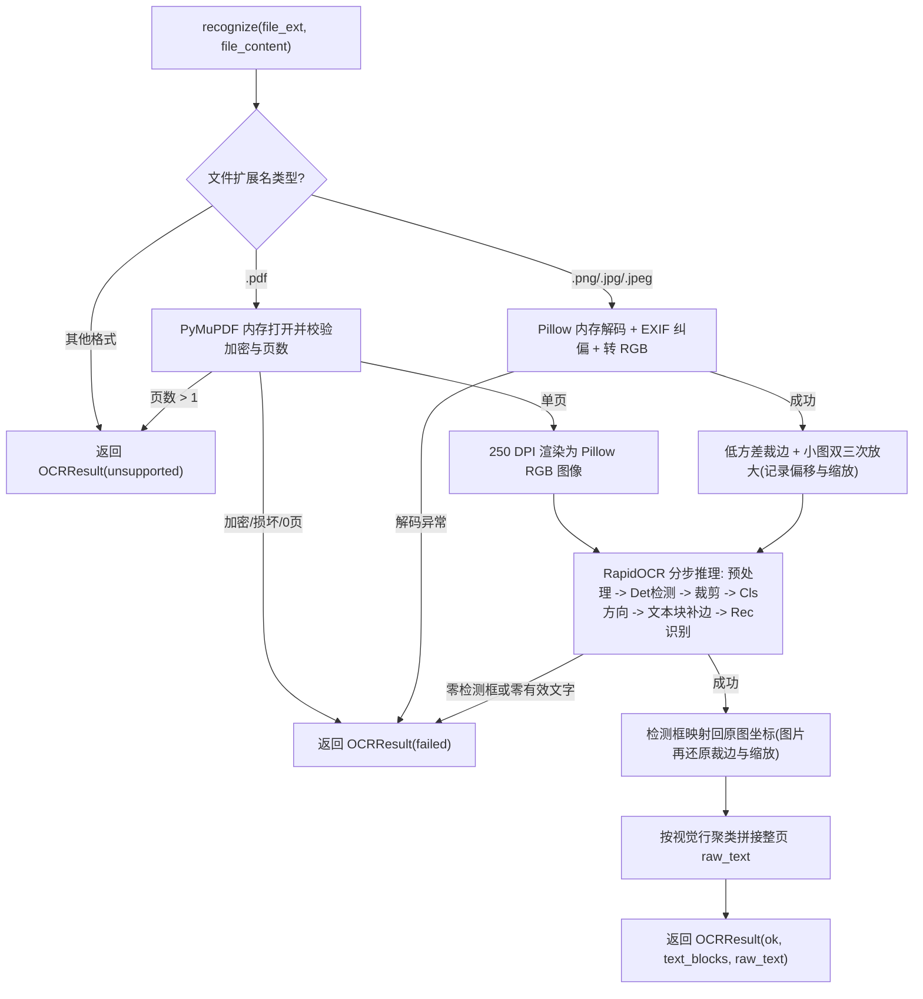

#### 伪代码

```text
类 OCREngine:
    方法 recognize(file_ext, file_content) -> OCRResult:
        若 file_ext 属于 {".png", ".jpg", ".jpeg"}:
            解码并 EXIF 纠偏转为 RGB 图像（失败返回 failed）
            (proc_img, crop_info) = _crop_and_scale_image(rgb_img)
            res = _recognize_rgb_image(proc_img)
            若 res.status == OK 且 crop_info 非空:
                按 crop_info 将所有 text_blocks 坐标逆映射回原始纠偏图像坐标系
            返回 res
        若 file_ext == ".pdf":
            用 PyMuPDF 内存打开（失败/加密/0页返回 failed，页数 > 1 返回 unsupported）
            以 PDF_RENDER_DPI(250) 渲染第 0 页为 RGB 图像
            返回 _recognize_rgb_image(rgb_img)
        返回 OCRResult(UNSUPPORTED)

    方法 recognize_roi(file_ext, file_content, roi_box) -> OCRResult:
        按整页像素坐标 roi_box 裁取图片或以 PyMuPDF clip 渲染 PDF 局部区域
        若长边 < 1600 则按 scale = min(2.5, 1800 / max_side) 放大渲染
        res = _recognize_rgb_image(roi_img)
        若 res.status == OK:
            将所有 text_blocks 坐标除以 scale 并加上 (roi_x_min, roi_y_min) 映射回整页坐标系
        返回 res

    方法 _recognize_rgb_image(rgb_image) -> OCRResult:
        执行 preprocess_img -> det_model -> crop_text_regions -> 可选 cls_model
        对每个文字块执行自适应补边 _pad_text_block（浅底补白，深底取外圈第 20 百分位）
        执行 rec_model 识别，map_boxes_to_original 还原检测框
        过滤空白文本，若为空返回 failed
        调用 _assemble_raw_text 按行间从上到下、行内从左到右拼接整页原文
        返回 OCRResult(OK, text_blocks, image_width, image_height, raw_text)
```

---

### 3.5 字段提取模块（`field_extractor.py`）

在整页文本块中独立确认两个正面局部区域（人像右侧上半区、卡片底部下半区），按无量纲相对几何（缩放与平移不变）提取九个标准字段，并在末尾按需挂载解耦补丁。

#### 3.5.1 FR-04「证号」专项提取规则

1. **排除页眉档案编码**：页眉 `档案编码：A...` 本身含噪声关键词被过滤；即使 OCR 将 `档案编码：` 与 `A...` 拆为两块，因提取严格限定在已确认上半区 `(0, 0)` 证号标签紧邻下方（`y < row1_label_y`）或同行紧邻右侧，且无标签锚点仅匹配 `^T\d{17}[\dXx]$`，绝不会误取页眉档案编码。
2. **通栏右界（关键纠偏）**：`证号` 处于人像右侧最顶行 `(0, 0)`，物理排版横跨左/右两栏宽度，因此提取时 **`col_right_limit = None`**（不以 `right_col_x` 截断），纵向底界 `y_bottom_limit = row1_label_y - 0.1 * ref_h`，水平仅通过同行块间明显间隔（`> 2.0 * label_h`）防止串入横版右侧背面卡。
3. **三条取值路径与分层校验**：
   - **路径 A（有“证号”标签且标签与值粘连，如 `证号：00123456` / `证号T44522...`）**：剥离前缀并合并同行连续碎块；
   - **路径 B（有“证号”标签，常规上下排布，或下方为空时受限查同行紧邻右侧块 `gap <= 2.0 * label_h`）**：收集通栏文本并合并同行连续碎块；
   - **路径 A/B 的文本编号校验（`_validate_cert_no_labeled`）**：去除空白后，要求严格由 ASCII 字母与数字（`^[A-Za-z0-9]{6,32}$`）组成、至少包含 4 位数字、非噪声词、非纯日期格式，**原样保留所有字母（如 `T`、`X`）和前导零（如 `004413...`）**；
   - **路径 C（“证号”标签漏检，仅由 `_find_cert_no_anchors` 识别到强特征值锚点，如 `黄伟平.jpg` / 压缩图）**：要求 `upper_anchors` 已通过至少 2 个不同槽位确认，且 `anchors["证号"]` 为 `is_value_anchor=True`（或在上半区左列起点上方唯一存在 `^T\d{17}[\dXx]$` 强格式块），直接保留该强特征文本。无证号标签时不放宽至普通纯数字，确保零错填。

#### 3.5.2 FR-05「有效期开始日期 / 有效期截止日期」双端点独立解析规则

1. **职责分离（零回归保证）**：
   - 原有 `_parse_date_range(text) -> Optional[Tuple[str, str]]` **保持严格完整双日期校验不变**，继续专用于 `_find_date_range_evidences`（无标签区域锚点确认与 `confirmed_range_bbox` 无标签初领日期恢复），避免半残缺日期降低区域定位阈值；
   - 新增 `_parse_validity_endpoints(text, matched_alias) -> Tuple[Optional[str], Optional[str]]`，专用于**已确认存在有效期限/有效期/有效期至标签**的栏位值解析。
2. **双端点独立判定规则**：
   - **Step 1（跨栏多日期污染守卫）**：先检索文本中全部日期匹配数；若出现 **3 个及以上日期片段**（如初领日期与有效期限发生跨栏粘连 `2026-09-20 2026-09-20至2032-09-19`），直接判为跨栏污染返回 `(None, None)`，完整守住 `fix2` 防跨栏红线。
   - **Step 2（完整双日期区间）**：尝试 `_parse_date_range(text)`；若命中且 `start_date <= end_date`，返回 `(start_date, end_date)`。若两合法日期之间存在区间连接符但 `end_date < start_date`（逻辑倒置，必然存在 OCR 年份错识），按零错填原则返回 `(None, None)`。
   - **Step 3（半残缺区间按分隔符左右独立定端）**：
     - 优先按明确区间连接符（`至`、`到`、`~`、`～`、`—`、`–`、`--`）分割，要求全文恰好存在 1 个此类连接符，切分为 `(left_raw, right_raw)`；
     - 若无上述明确连接符，再检查是否处于“完整日期 + 尾部 `-` + 非日期残缺”或“非日期残缺 + 前导 `-` + 完整日期”形态（要求 `-` 严格位于完整日期匹配之外，绝不误拆日期内部的 `YYYY-MM-DD` 连字符）；
     - 分割后分别独立校验：
       - 若 `left_raw` 恰好为唯一合法单日期（`_parse_single_date(left_raw)` 非空），则 `start_date = 该日期`，否则 `None`；
       - 若 `right_raw` 恰好为唯一合法单日期（`_parse_single_date(right_raw)` 非空），则 `end_date = 该日期`，否则 `None`；
       - 若两边均合法且 `end_date < start_date`，则双端均置为 `None`；
       - 典型覆盖：`2022-08-29 至` → `("2022-08-29", None)`；`2022-08-29至2031-55-12` → `("2022-08-29", None)`；`至 2028-08-28` → `(None, "2028-08-28")`。
   - **Step 4（无区间分隔符的单日期判定）**：
     - 仅当 `matched_alias in VALID_UNTIL_EXACT_LABELS`（如 `有效期至`）且 `_parse_single_date(text)` 合法时，返回 `(None, single_date)`；
     - 若标签仅为 `有效期限` / `有效期` 且仅见单个无分隔符日期，无法确定属于起日还是止日，返回 `(None, None)`。
3. **两项配套同行/左端缺失容错**：
   - **“有效期至”同行拆块**：当标签为 `有效期至`、无 `inline_value` 且下方未取到值时，受限检查标签同行紧邻右侧块（`gap <= 2.0 * label_h`、非噪声/非标签），防止 `["有效期至", "2028-08-28"]` 拆成两块时漏识。
   - **起始端彻底丢失的右端残缺块**：当标签为 `有效期限`/`有效期` 且标签正下方左对齐收块为空时，受限在底栏第一行右栏窗口 `[col_start_x, col_start_x + 10 * label_h]` 内查找以明确区间连接符（`至`/`到`/`~`/`—`）开头且仅含唯一合法日期的候选块（如 `至2028-08-28`），避免因起日完全不可见导致止日坐标右偏超 `1.8h` 而漏检。
4. **`validity_block_indices` 联动**：在有标签解析路径下，只要 `start_date is not None or end_date is not None`，即把所采纳文本块索引全部并入 `validity_block_indices`，传给后续 `初领日期` 提取逻辑排除，保证新版微左偏版式下即使半残缺区间也不会误杀 `初领日期`。

#### 流程图

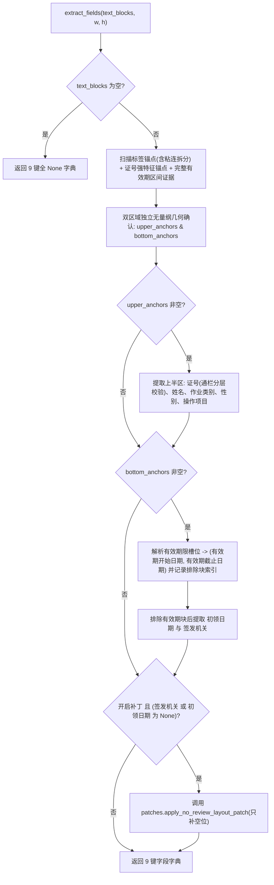

#### 伪代码

```text
函数 extract_fields(text_blocks, image_width, image_height) -> FieldDict:
    fields = create_empty_fields()   # 9 键全 None
    若 text_blocks 为空: 返回 fields

    label_tokens = _find_label_tokens(text_blocks)
    label_block_indices = {tok.block_idx 对 tok 属于 label_tokens}
    cert_no_anchors = _find_cert_no_anchors(text_blocks, label_tokens)       # 仅 ^T\d{17}[\dXx]$
    range_evidences = _find_date_range_evidences(text_blocks, label_block_indices)  # 仅完整双日期

    upper_anchors = _confirm_region(_UPPER_SLOTS, label_tokens, extra=cert_no_anchors)
    bottom_anchors = _confirm_region(_BOTTOM_SLOTS, label_tokens, extra=range_evidences 映射至 VALIDITY_SLOT_KEY)

    若 upper_anchors 非空:
        _extract_upper_region(upper_anchors, text_blocks, label_block_indices, bottom_top_y, fields)

    若 bottom_anchors 非空:
        _extract_bottom_region(bottom_anchors, text_blocks, label_block_indices, range_evidences, fields)

    若 enable_patches 且 (fields["签发机关"] 为 None 或 fields["初领日期"] 为 None):
        apply_no_review_layout_patch(text_blocks, fields)

    返回 fields


函数 _extract_cert_no(upper_anchors, row1_label_y, left_col_x, ref_h, text_blocks, label_block_indices) -> Optional[str]:
    cert_anchor = upper_anchors.get("证号")
    y_limit = row1_label_y - 0.1 * ref_h 若 row1_label_y 非空 否则 None

    # 情况 1：有“证号”标签锚点（含粘连）-> 通栏提取（col_right_limit=None）+ 宽松文本编号校验
    若 cert_anchor 非空 且 cert_anchor.label_token 非空:
        raw = _collect_labeled_field_value(
            token=cert_anchor.label_token,
            col_start_x=cert_anchor.bbox.x,
            col_right_limit=None,           # 关键：证号为顶部通栏，绝不按作业类别列截断
            y_bottom_limit=y_limit,
            allow_multiline=False,
            is_left_col=False,
        )
        若 raw 为 None 且 cert_anchor.label_token.inline_value 为 None:
            raw = _collect_inline_right_neighbor(cert_anchor.label_token, text_blocks, label_block_indices, ref_h)
        返回 _validate_cert_no_labeled(raw)  # 去空白，校验 ^[A-Za-z0-9]{6,32}$ 且至少4位数字、非日期/非噪声，原样保留字母与前导零

    # 情况 2：无“证号”标签，但强特征证号值本身已作为锚点确认（如黄伟平/压缩图）
    若 cert_anchor 非空 且 cert_anchor.is_value_anchor:
        compact = 去除空白(cert_anchor.bbox.text)
        返回 compact 若 _CERT_NO_RE.match(compact) 否则 None

    返回 None


函数 _parse_validity_endpoints(raw_text: str, matched_alias: str) -> Tuple[Optional[str], Optional[str]]:
    compact = 去除空白(raw_text)
    若 compact 为空: 返回 (None, None)

    # 1. 跨栏多日期污染守卫（出现 >=3 个日期片段立即拒绝）
    若 len(_SINGLE_DATE_RE.findall(compact)) >= 3:
        返回 (None, None)

    # 2. 尝试完整双日期区间
    full_range = _parse_date_range(compact)
    若 full_range 非空:
        返回 full_range   # (start_iso, end_iso)

    # 3. 尝试单区间连接符分割（优先明确符号：至/到/~/～/—/–/--；次选日期外部连字符 -）
    split_res = _split_by_single_range_separator(compact)
    若 split_res 非空:
        (left_raw, right_raw) = split_res
        start_iso = _parse_single_date(left_raw) 若 left_raw 非空 否则 None
        end_iso = _parse_single_date(right_raw) 若 right_raw 非空 否则 None
        # 若两端均合法但逻辑倒置（如 2028-08-28至2022-08-29），双端拒绝防错填
        若 start_iso 非空 且 end_iso 非空 且 end_iso < start_iso:
            返回 (None, None)
        返回 (start_iso, end_iso)

    # 4. 无区间分隔符：仅“有效期至”标签可直接认定单止日
    若 matched_alias 属于 VALID_UNTIL_EXACT_LABELS:
        single_iso = _parse_single_date(compact)
        返回 (None, single_iso) 若 single_iso 非空 否则 (None, None)

    # 5. 普通“有效期限/有效期”标签下仅有单日期且无分隔符 -> 归属不明
    返回 (None, None)
```

---

### 3.6 2026 新版“无复审”底栏解耦补丁模块（`patches/no_review_layout_patch.py`）

针对 2026 新版底图取消“应复审日期”、将“签发机关”左移至 `(2, 0)` 的版式变更，保持与主识别逻辑物理隔离。同步 FR-05 后，补丁内有效期提取由单止日升级为双端点独立解析，继续严格执行**双重门控、只补空位（Fill-Missing-Only）、异常静默回退**三大铁律。

#### 流程图

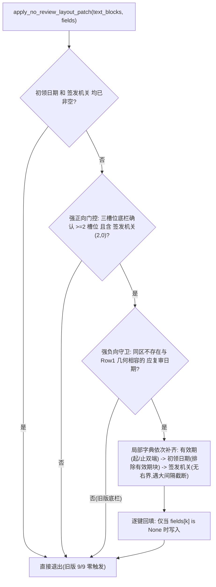

#### 伪代码

```text
函数 apply_no_review_layout_patch(text_blocks, fields) -> None:
    尝试:
        若 fields["初领日期"] 非空 且 fields["签发机关"] 非空:
            返回

        (passed, anchors, ref_h) = _check_no_review_layout_gates(text_blocks)
        若 非 passed: 返回

        patch_fields = {}
        validity_block_indices = set()
        confirmed_range_bbox = None

        # 1. 若有效期起/止任一缺失且存在有效期限锚点，独立解析双端点
        若 (fields["有效期开始日期"] 为 None 或 fields["有效期截止日期"] 为 None) 且 "有效期限" 在 anchors 中:
            (start_d, end_d, range_bbox, used_idx) = _extract_validity_dates(anchors["有效期限"], text_blocks, ref_h)
            若 start_d 非空: patch_fields["有效期开始日期"] = start_d
            若 end_d 非空: patch_fields["有效期截止日期"] = end_d
            若 start_d 非空 或 end_d 非空:
                validity_block_indices = used_idx
            若 start_d 非空 且 end_d 非空:
                confirmed_range_bbox = range_bbox

        # 2. 若初领日期缺失，在排除 validity_block_indices 后按标签或区间同排左侧提取
        若 fields["初领日期"] 为 None:
            patch_fields["初领日期"] = _extract_first_issue_date(...)

        # 3. 若签发机关缺失，在 (2, 0) 左栏无右界（大间隔截断）收集并校验机关结尾
        若 fields["签发机关"] 为 None:
            patch_fields["签发机关"] = _extract_issuing_org(...)

        # 只补空位（绝不覆盖原版已有值）
        遍历 (k, v) 属于 patch_fields:
            若 fields.get(k) 为 None 且 v 非空:
                fields[k] = v
    捕获 任意异常:
        静默回退，保持原版 fields 不变
```

---

### 3.7 两阶段识别与复核模块（`two_stage_processor.py`）

在一阶段整页识别出现缺失或操作项目截字疑点时，基于非噪声已识别字段反推正面卡片 ROI，调用 `ocr_engine.recognize_roi` 局部放大复识，再以保守策略合并结果。

#### 针对 FR-04 / FR-05 的两项关键协同设计

1. **避免“有效期至”单止日证件误触发二阶段复核**：若缺失键**仅有** `有效期开始日期`，且 `有效期截止日期` 非空，且 `text_blocks` 中存在标准化后属于 `VALID_UNTIL_EXACT_LABELS`（如 `有效期至`）的标签块，说明该证件本身仅标明截止日期（属合法空值而非漏检），直接结束，不触发耗时的局部复识。
2. **合并后有效期起止一致性校验**：两阶段逐键保守合并（一致保留、单边非空保留、双边冲突置空）完成后，若最终 `有效期开始日期` 与 `有效期截止日期` 均非空但 `start > end`，说明两阶段跨端点合并产生了逻辑矛盾，将两项均置为 `None`，严守零错填原则。

#### 流程图

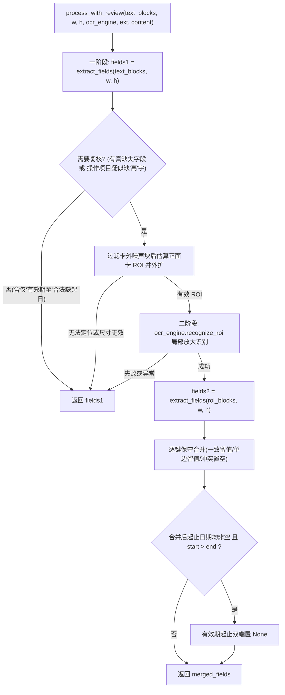

#### 伪代码

```text
函数 process_with_review(text_blocks, w, h, ocr_engine, ext, content):
    fields1 = extract_fields(text_blocks, w, h)
    (needs_review, reason) = _check_needs_review(fields1, text_blocks)
    若 非 needs_review:
        返回 (fields1, text_blocks, "无需复核")

    roi_box = _estimate_front_card_roi(text_blocks, fields1, w, h)  # 跳过 _is_noise_text 块
    若 roi_box 为 None:
        返回 (fields1, text_blocks, "无法定位正面区域")

    尝试:
        roi_res = ocr_engine.recognize_roi(ext, content, roi_box)
        若 roi_res.status != OK 或 roi_res.text_blocks 为空:
            返回 (fields1, text_blocks, "局部识别失败")
        fields2 = extract_fields(roi_res.text_blocks, w, h)
        merged = _merge_fields(fields1, fields2)
        返回 (merged, text_blocks, "两阶段复核完成")
    捕获 异常:
        返回 (fields1, text_blocks, "局部复核异常，保留一阶段结果")

函数 _check_needs_review(fields, text_blocks) -> Tuple[bool, str]:
    missing = [k 对 k, v 属于 fields 若 v 为 None]
    若 missing == ["有效期开始日期"] 且 fields.get("有效期截止日期") 非空:
        若 text_blocks 中存在标准化后以 "有效期至" 开头或匹配的标签块:
            missing = []   # 合法的单止日证件，免于无效复核
    若 missing 非空:
        返回 (True, "存在缺失字段")
    若 fields.get("操作项目") 含 "处安装" 且不含 "高":
        返回 (True, "操作项目疑似截字")
    返回 (False, "")

函数 _merge_fields(fields1, fields2) -> FieldDict:
    merged = create_empty_fields()
    遍历 k 属于 FIELD_KEYS:
        v1, v2 = fields1.get(k), fields2.get(k)
        若 v1 == v2: merged[k] = v1
        否则若 v1 非空 且 v2 为 None: merged[k] = v1
        否则若 v1 为 None 且 v2 非空: merged[k] = v2
        否则: merged[k] = None   # 冲突保守置空
    # 跨阶段起止日期一致性校验
    若 merged["有效期开始日期"] 非空 且 merged["有效期截止日期"] 非空:
        若 merged["有效期开始日期"] > merged["有效期截止日期"]:
            merged["有效期开始日期"] = None
            merged["有效期截止日期"] = None
    返回 merged
```

---

### 3.8 数据持久化模块（`data_repository.py`）

使用标准库 `sqlite3`，每个连接启用 `PRAGMA foreign_keys = ON`，单文件处理结果严格在单个原子事务中提交。

#### 3.8.1 四表物理 Schema 设计（零侵入既有两表）

采用“保留原有 `files` 与 `extracted_fields` + 新增 `certificates` 与 `certificate_files`”的非侵入式四表设计：
- **零破坏升级**：不改动存量 `files` 与 `extracted_fields` 表结构，既有的 `_migrate_legacy_files` 迁移保护机制与历史 7 字段库完全无损兼容；
- **严格基数约束**：`certificate_files.file_id` 设为 `PRIMARY KEY` 且外键关联 `files(file_id) ON DELETE CASCADE`，数据库层天然保证每份源文件至多关联 **1 条**证件记录（`0..1`）；`(cert_no, work_category)` 作为复合外键关联 `certificates(cert_no, work_category)` 并建查询索引，天然支持 **1 张证件关联多份源文件（`1 : N`）**；
- **文本保真与防空串**：`cert_no` 与 `work_category` 均为 `TEXT NOT NULL`，并附加 `CHECK (length(trim(cert_no)) > 0 AND length(trim(work_category)) > 0)`，保留前导零与字母，杜绝空串或半残缺主键入库；
- **独立溯源不覆盖**：`certificates` 仅作为轻量证件归并主体（存联合主键与创建/更新时间），不冗余覆盖各份源文件的字段值，确保同号同类的多份源文件（如高清版与截图版、复审前后版本）各自完整的识别原文与九条字段均可按 `file_id` 独立查回。

#### 数据库实体关系图（ER Diagram）

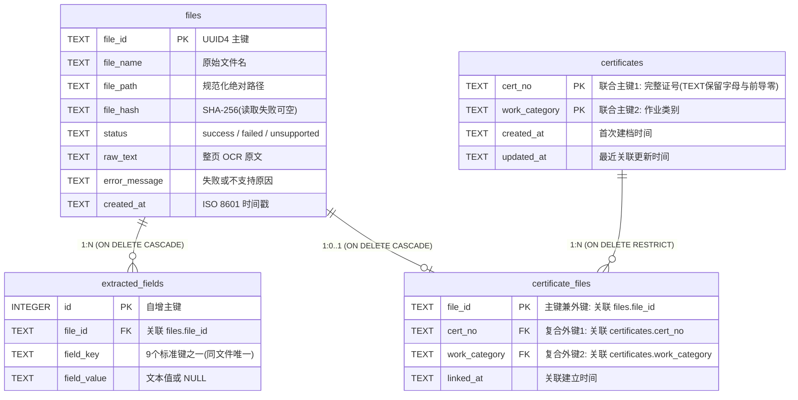

#### 3.8.2 历史 7 字段库兼容与幂等边界

1. **只读查询兼容**：历史 7 字段成功记录（未含新增两键、未建 `certificate_files` 关联）仍可按原 `file_id` 完整查回：`query_by_file_id` 忠实返回 `extracted_fields` 中持久化的原 7 键（缺少的新增值视作未知/`None`），`certificate_key` 为 `None`；新 9 字段成功记录写齐 9 行并返回 9 键。
2. **幂等边界**：`idx_files_success_path_hash` 局部唯一索引维持 `(file_path, file_hash) WHERE status = 'success' AND file_hash IS NOT NULL`，同路径同哈希已有成功记录时仍跳过并保留原 `file_id`。若需对旧 7 字段历史库中的文件补提新增两字段并建立证件关联，应使用独立新库重跑或按需清理旧库后重跑（遵循最小化设计，不做在线覆盖篡改历史快照）。

#### 3.8.3 仓储接口契约

| 仓储操作 | 事务与返回契约 |
|---|---|
| `find_existing_success_id(file_path, file_hash)` | 仅查 `status='success'` 记录，命中返回原 `file_id`。 |
| `save_success(file_info, raw_text, fields)` | 单事务校验 `file_hash` 非空、严格 9 键、至少 1 个非空值；依次写 `files`、9 行 `extracted_fields`；当 `extract_certificate_key(fields)` 非空时，在同一事务内原子 upsert `certificates` 并写入 `certificate_files`；缺任一主键字段时跳过后两步。任一步骤异常整笔回滚。 |
| `save_non_success(file_info, status, error_message, raw_text=None)` | 单事务保存 `failed` 或 `unsupported`，零字段、不写证件及关联表。 |
| `query_by_file_id(file_id)` | 查回 `files`、`extracted_fields` 及 `certificate_files`（填充 `certificate_key`）；失败/不支持记录也可查询，其 `fields={}`、`certificate_key=None`。 |
| `query_by_certificate_key(cert_no, work_category)` | **新增**：按联合主键查回 `CertificateRecord`（含全部关联 `file_ids`），不存在返回 `None`。 |
| `query_files_by_certificate_key(cert_no, work_category)` | **新增**：按联合主键查回该证件关联的全部 `ProcessResult` 列表，每份文件的独立识别结果完整可查。 |
| `query_all_files()` / `query_all_certificates()` | 按入库顺序枚举全部文件记录或全部证件归并记录。 |

#### 流程图（`save_success` 单事务原子写入流程）

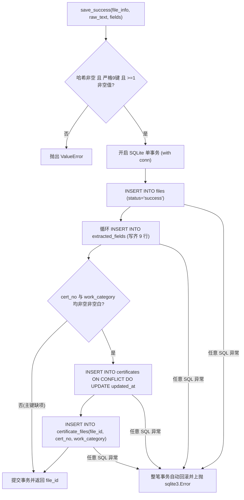

#### 伪代码

```text
建表 DDL（_init_database 在 BEGIN IMMEDIATE 锁内执行）:
    CREATE TABLE IF NOT EXISTS files (... 保持既有结构不变 ...)
    _migrate_legacy_files(conn)   # 保持既有旧约束迁移不变
    CREATE UNIQUE INDEX IF NOT EXISTS idx_files_success_path_hash
        ON files(file_path, file_hash) WHERE status = 'success' AND file_hash IS NOT NULL
    CREATE TABLE IF NOT EXISTS extracted_fields (... 保持既有结构不变 ...)
    CREATE TABLE IF NOT EXISTS certificates (
        cert_no TEXT NOT NULL,
        work_category TEXT NOT NULL,
        created_at TEXT NOT NULL,
        updated_at TEXT NOT NULL,
        PRIMARY KEY (cert_no, work_category),
        CHECK (length(trim(cert_no)) > 0 AND length(trim(work_category)) > 0)
    )
    CREATE TABLE IF NOT EXISTS certificate_files (
        file_id TEXT PRIMARY KEY,
        cert_no TEXT NOT NULL,
        work_category TEXT NOT NULL,
        linked_at TEXT NOT NULL,
        FOREIGN KEY (file_id) REFERENCES files(file_id) ON DELETE CASCADE,
        FOREIGN KEY (cert_no, work_category)
            REFERENCES certificates(cert_no, work_category) ON DELETE RESTRICT
    )
    CREATE INDEX IF NOT EXISTS idx_cert_files_cert_key
        ON certificate_files(cert_no, work_category)

函数 save_success(file_info, raw_text, fields) -> str:
    校验 file_info.file_hash 非空
    校验 set(fields.keys()) == set(FIELD_KEYS)   # 严格 9 键
    校验 count_non_empty_fields(fields) >= 1

    file_id = uuid4()
    now = utc_now_iso8601()
    cert_key = extract_certificate_key(fields)

    在单个事务 conn 中:
        INSERT INTO files (...) VALUES (file_id, ..., 'success', raw_text, NULL, now)
        遍历 key 属于 FIELD_KEYS:
            INSERT INTO extracted_fields (file_id, field_key, field_value) VALUES (file_id, key, fields[key])
        若 cert_key 非空:
            (cert_no, work_category) = cert_key
            INSERT INTO certificates (cert_no, work_category, created_at, updated_at)
                VALUES (cert_no, work_category, now, now)
                ON CONFLICT(cert_no, work_category) DO UPDATE SET updated_at = excluded.updated_at
            INSERT INTO certificate_files (file_id, cert_no, work_category, linked_at)
                VALUES (file_id, cert_no, work_category, now)
    返回 file_id

函数 query_by_file_id(file_id) -> Optional[ProcessResult]:
    查询 files 行，不存在返回 None
    查询 extracted_fields 组装 fields 字典（忠实还原持久化键值对）
    查询 certificate_files 获取 (cert_no, work_category) -> certificate_key（无则为 None）
    返回 ProcessResult(..., certificate_key=certificate_key)

函数 query_by_certificate_key(cert_no, work_category) -> Optional[CertificateRecord]:
    查询 certificates 主键记录，不存在返回 None
    按 linked_at / rowid 升序查询 certificate_files 获取全部 file_ids
    返回 CertificateRecord(cert_no, work_category, file_ids, created_at, updated_at)

函数 query_files_by_certificate_key(cert_no, work_category) -> List[ProcessResult]:
    record = query_by_certificate_key(cert_no, work_category)
    若 record 为 None: 返回 []
    返回 [query_by_file_id(fid) 对 fid 属于 record.file_ids 若结果非空]
```

---

### 3.9 主流程编排模块（`main.py`）

CLI 入口接收必填 `--input`、可选 `--db` 与可选 `--fast`。正式模式固定高精度模型与 `./data/ocr.db`，`--fast` 快速联调模式强制隔离至独立测试库（默认 `./data/ocr_fast.db`，拒绝写入正式默认库）。进度日志字段总数改用 `len(FIELD_KEYS)` 动态输出（不再硬编码 `/7`）。

#### 流程图

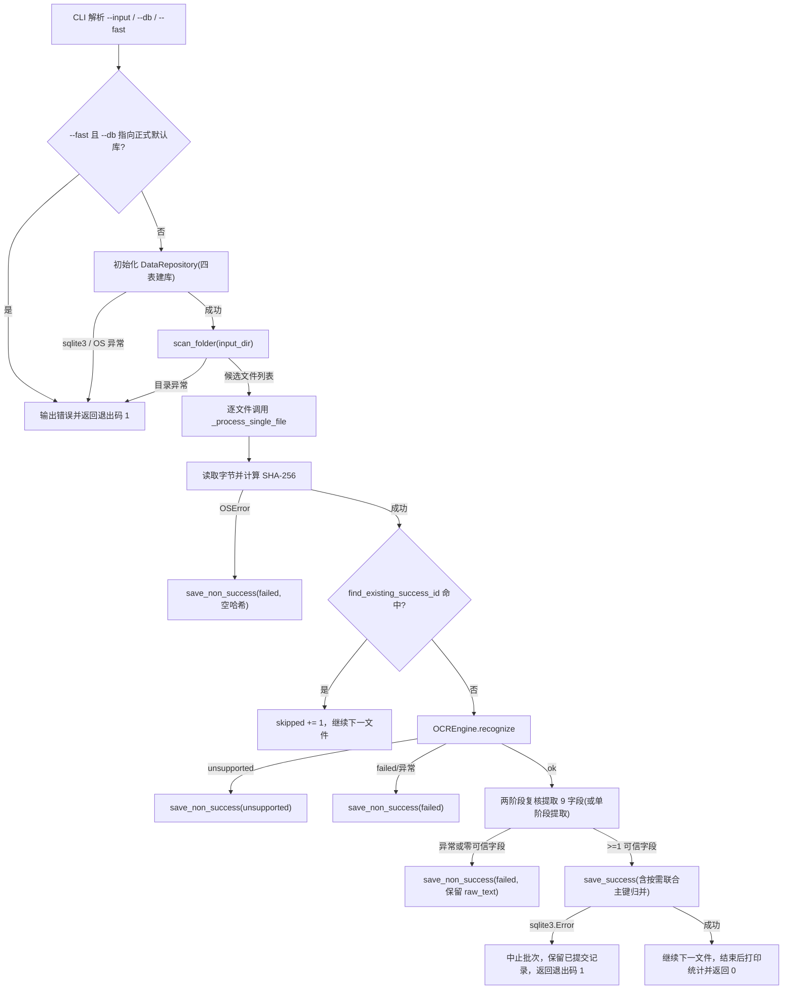

#### 伪代码

```text
函数 main(argv) -> int:
    解析参数 --input, --db, --fast
    若 fast 且 显式 --db 解析后等于 DEFAULT_DB_PATH:
        打印错误至 stderr 并返回 1
    初始化 processor = OCRProcessor(db_path, fast_mode=fast)
    ok = processor.process_folder(input_dir)
    返回 0 若 ok 否则 1

函数 _process_single_file(file_path):
    (content, file_hash, err) = _read_file(norm_path)
    若 content 为 None:
        db.save_non_success(file_info(hash=None), "failed", err, raw_text=None)
        stats["failed"] += 1; 返回

    若 db.find_existing_success_id(norm_path, file_hash) 非空:
        stats["skipped"] += 1; 返回

    ocr_res = _get_ocr_engine().recognize(file_ext, content)  # 捕获非数据库异常并登记 failed
    若 ocr_res.status 属于 (UNSUPPORTED, FAILED):
        db.save_non_success(file_info, ocr_res.status, ocr_res.error_message, raw_text=None)
        累加对应统计并返回

    尝试:
        若 enable_two_stage:
            (fields, _, _) = process_with_two_stage_review(ocr_res.text_blocks, ocr_res.image_width, ocr_res.image_height, ocr_engine, file_ext, content)
        否则:
            fields = extractor(ocr_res.text_blocks, ocr_res.image_width, ocr_res.image_height)
    捕获 异常 exc:
        db.save_non_success(file_info, "failed", f"字段提取异常: {exc}", raw_text=ocr_res.raw_text)
        stats["failed"] += 1; 返回

    non_empty = count_non_empty_fields(fields)
    若 non_empty == 0:
        db.save_non_success(file_info, "failed", "未能从正面证件区域提取出有效字段", raw_text=ocr_res.raw_text)
        stats["failed"] += 1; 返回

    file_id = db.save_success(file_info, ocr_res.raw_text, fields)   # sqlite3.Error 向上传播中止批次
    stats["success"] += 1
    打印 f"[成功: {non_empty}/{len(FIELD_KEYS)} 字段 | file_id={file_id}]"
```

---

## 四、OCR 技术选型与已有评测

### 4.1 当前生效 OCR 推理架构规格

正式流程采用 RapidOCR 3 系列与 ONNX Runtime 的 CPU 后端，并辅以图片低方差裁边、小图双三次放大（`max_side < 1500` 或 `min_side < 950` 时放大至上限 `2.0x`）、文字块自适应补边以及按需局部 ROI 复核。

| 项目 | 正式高精度取值 | 开发快速联调取值（`--fast`） |
|---|---|---|
| 检测模型 | `ch_PP-OCRv4_det_mobile.onnx`（4.53 MB） | `ch_PP-OCRv4_det_mobile.onnx` |
| 识别模型 | `ch_PP-OCRv5_rec_server.onnx`（80.66 MB） | `ch_PP-OCRv4_rec_mobile.onnx`（10.35 MB） |
| 图像限长参数 | `Global.max_side_len=4600`、`Det.limit_type=max`、`Det.limit_side_len=3200` | 同左 |
| 隔离数据库 | `./data/ocr.db` | `./data/ocr_fast.db`（禁止写入正式默认库） |

### 4.2 历史模型选型对比记录（基准参考）

下表保留 V2.0 在 Windows、Intel Core i7-9750H、Python 3.12、`uv` 环境记录的原始选型评测数据（退化样本由原图缩放至 `0.65×`、JPEG `Q55` 编码得到）：

| 候选方案 | 模板1 原图 | 模板2 原图 | 模板1 模拟压缩 | 模板2 模拟压缩 | 单图 CPU 耗时 | 选型依据 |
|---|---|---|---|---|---|---|
| **方案 1，正式高精度**　PP-OCRv4 Mobile Det ＋ PP-OCRv5 Server Rec | 标签 **7/7**、值 **8/8**（`avg=0.997`） | 标签 **7/7**、值 **7/7**（`avg=0.993`） | 标签 2/7、值 7/8，日期、机关及操作项目正确 | 标签 **7/7**、值 **7/7**（`avg=0.989`） | 35～41 秒 | 选作正式组合，清晰原图全部命中 |
| 方案 2，快速联调　PP-OCRv4 Mobile Det ＋ PP-OCRv4 Mobile Rec | 标签 7/7、值 8/8（`avg=0.992`） | 标签 7/7、值 7/7（`avg=0.991`） | 标签 0/7、值 7/8 | 标签 6/7（漏字）、值 7/7 | 2.7～6.8 秒 | 联调耗时短，作为 `--fast` 模式 |
| 方案 3　PP-OCRv5 Mobile Det ＋ PP-OCRv5 Mobile Rec | 备注丢字、边框误检 | 标签 6/7，“初领日期”误识为“初领目期” | 误识率偏高 | 存在字符误识 | 2.8～3.0 秒 | 小字形近字误识偏高 |
| 方案 4　PP-OCRv5 Mobile Det ＋ PP-OCRv5 Server Rec | 标签 7/7、值 8/8（`avg=0.977`） | 值 6/7，“登高架设作业”漏“高” | 出现 `2031-55-12` 与“男男” | 标签 7/7、值 7/7 | 26～36 秒 | 存在检测框偏移 |
| 方案 5　PP-OCRv4 Mobile Det ＋ PP-OCRv4 Server Rec | 标签 7/7、值 8/8（`avg=0.996`） | 标签 7/7、值 7/7（`avg=0.990`） | 值 8/8 | 标签 7/7、值 7/7 | 130～159 秒 | 耗时过长 |
| 方案 6　PP-OCRv5 Server Det ＋ PP-OCRv5 Server Rec | 限长 2800 时 9/9，限长 1280 漏检 | 标签 9/9、值 7/7 | 标签 2/7、值 7/8 | 标签 7/7、值 7/7 | 54～66 秒 | 检测模型较大，降限长漏小字 |

### 4.3 运行依赖

| 组件 | 技术选型 | 说明 |
|---|---|---|
| 语言与包管理 | Python 3.12 / `uv`（`pyproject.toml`） | 统一使用 `uv run` 执行 |
| OCR 引擎与图像处理 | `rapidocr` + `onnxruntime` + `opencv-python` + `numpy` + `Pillow` | 本地离线 CPU 推理与图像预处理 |
| PDF 校验与渲染 | `PyMuPDF` (`pymupdf`) | 内存页数校验、加密校验及单页/ROI 渲染 |
| 数据存储 | 标准库 `sqlite3` | 单文件事务、联合主键与外键原生支持 |
| 日期与正则解析 | 标准库 `re` + `datetime` | 严格日历校验与区间端点分离 |

---

## 五、目录结构规划（对齐最新仓库布局）

```text
E:/D/zuoyewenjian/MyProject/ocr/
├── pyproject.toml                       # uv 项目配置与最小核心依赖
├── main.py                              # CLI 入口（含 --fast）、逐文件读取与哈希、状态编排
├── config.py                            # 9 字段常量、有效期限逻辑槽位与双档 OCR 配置
├── models.py                            # 标准数据契约（含 CertificateRecord 与主键辅助函数）
├── file_scanner.py                      # 枚举当前层候选路径、过滤扩展名并排序
├── ocr_engine.py                        # 媒体校验、裁边缩放补边、整页与 ROI 识别
├── field_extractor.py                   # 双区域 9 字段提取、证号通栏取值、有效期双端点独立解析
├── two_stage_processor.py               # 两阶段局部放大复核、噪声过滤与保守合并
├── data_repository.py                   # SQLite 四表事务持久化、旧库迁移与双维查询
├── patches/                             # 与主逻辑解耦的版式补丁目录
│   ├── __init__.py
│   └── no_review_layout_patch.py        # 2026 新版“无复审”底栏解耦补丁（同步支持有效期双端点）
├── prd/                                 # 需求分析文档目录
│   ├── prd(已完成).md                   # 一期需求说明书 V1.1
│   └── prd1.md                          # FR-04 / FR-05 增量需求文档
├── moduleDesign/                        # 唯一模块设计文档目录
│   └── prd-md-ocr-snug-cherny.md        # 本架构设计文档（V3.0）
├── fix/                                 # 缺陷专项方案与实施记录
├── debug/                               # 调试与核验脚本目录
├── tests/                               # 自动化单元测试与集成测试
├── 证件模板/                            # 样本数据集（set1 / set2）
└── data/                                # 运行时数据库目录（ocr.db / ocr_fast.db）
```

---

## 六、异常处理与容错矩阵

| 场景 | 文件状态 | 内容哈希 | 整页原文 | 字段行 | 证件关联（`certificates` / `certificate_files`） | 后续处理 |
|---|---|---|---|---|---|---|
| 正面确认，>=1 字段可信，且 `证号`与`作业类别`均非空 | `success` | 已取得 | 保存 | 9 行，缺项存 `NULL` | 同事务建立或复用 `(证号, 作业类别)` 并绑定 `file_id` | 提交事务，继续 |
| 正面确认，>=1 字段可信，但 `证号`或`作业类别`任一缺失 | `success` | 已取得 | 保存 | 9 行，缺项存 `NULL` | **不建档、不关联**，保留原字段与 `file_id` 追溯 | 提交事务，继续 |
| 同路径同哈希已有 `success` 记录 | 跳过 | 已取得 | 沿用 | 沿用原记录 | 沿用原关联 | 保留原 `file_id` |
| 文件被占用或消失，无法读取 | `failed` | `NULL` | `NULL` | 零行 | 无 | 保存路径和原因，继续 |
| 多页 PDF | `unsupported` | 已取得 | `NULL` | 零行 | 无 | 跳过渲染及 OCR，继续 |
| 损坏/加密/零页/空白媒体 | `failed` | 已取得 | `NULL` | 零行 | 无 | 保存原因，继续 |
| 仅卡外干扰或零个可信字段 / 提取异常 | `failed` | 已取得 | 保存已取得原文 | 零行 | 无 | 保存失败原因，继续 |
| 补丁内部异常 | 静默回退 | 已取得 | 保存 | 保留主提取器结果 | 按主提取器结果判定 | 不中断单文件处理 |
| 数据库不可用或写四表任一步骤失败 | 批次故障 | — | — | 整笔回滚 | 整笔回滚（无半截证件/关联） | 报告错误并非零退出 |

---

## 七、验证与验收方案

### 7.1 模块级单元测试矩阵（含 FR-04 / FR-05 全边界）

| 验证模块 | 关键用例与断言要点 |
|---|---|
| **FR-04 证号提取** | 1. 清晰原图与缩放/平移后提取完整证号（`T445221199507034550`、`T441322198911030010`），不因右边界越过 `作业类别` 列起点而被跨栏误杀。<br>2. 模拟纯数字带前导零证号（如 `00441322001234`）与含字母编号（如 `A00123X`），在有“证号”标签时按文本完整保留前导零与字母；支持 `证号：00123456` 粘连与 `["证号", "00123456"]` 同行两块。<br>3. 无“证号”标签时（如 `黄伟平.jpg`、`compressed_t1`），仅认强特征 `^T\d{17}[\dXx]$`，绝不把页眉 `档案编码：A...`（含拆分为两块情形）误提取为证号。 |
| **FR-05 有效期双端点** | 1. 完整区间 `2022-08-29至2028-08-28`（含单块、同行三拆块及斜杠/点/中文日期格式）：起日=`2022-08-29`，止日=`2028-08-28`，`初领日期` 保持 `2019-03-06`。<br>2. 明确“有效期至”标签 + `2028-08-28`（含上下排布、同行粘连、同行两块）：止日=`2028-08-28`，起日=`None`。<br>3. 仅能辨认左端：`2022-08-29 至` / `["2022-08-29", "至"]` / `2022-08-29至2031-55-12` → 起日=`2022-08-29`，止日=`None`。<br>4. 仅能辨认右端：`至 2028-08-28` / `2022-99-29至2028-08-28` → 起日=`None`，止日=`2028-08-28`。<br>5. 普通“有效期限”下仅有单个无分隔符日期 `2028-08-28` → 起止双空 `(None, None)`。<br>6. 起止倒置 `2028-08-28至2022-08-29` 或跨栏三日期粘连 `2026-09-20 2026-09-20至2032-09-19` → 起止双空且不破坏 `初领日期` 跨栏防线。 |
| **新版补丁与两阶段协作** | 1. 谢鹏飞新版无复审实测文本块达到 `9/9`；模拟新版初领日期标签漏检时，补丁能同步补齐有效期起止日与初领日期；半残缺有效期在新版左偏 `0.71h` 场景下不误杀 `初领日期`。<br>2. “有效期至 2028-08-28”单止日证件在 8/9 其余全齐时，`_check_needs_review` 返回 `False`（免于无效二阶段复核）。<br>3. 两阶段合并结果若出现跨阶段 `start > end`，自动双端置 `None`。 |
| **FR-04 联合主键持久化** | 1. **同号异类**：两份文件证号相同，作业类别分别为 `电工作业` 和 `高处作业` → `certificates` 存 2 条独立记录，`certificate_files` 各自关联对应 `file_id`。<br>2. **同号同类**：两份文件证号和作业类别均相同（不同路径或不同内容哈希）→ `certificates` 仅 1 条记录，`query_files_by_certificate_key` 查回 2 条独立 `ProcessResult`，且各自按 `file_id` 可查回独立原文与 9 条字段。<br>3. **主键缺项**：`证号` 为 `None` 或 `作业类别` 为 `None`（或空串）→ 保存 `files` 与 9 条字段，缺失字段为 `NULL`，`certificates` 与 `certificate_files` 均为 0 行，`ProcessResult.certificate_key` 为 `None`。<br>4. **历史 7 字段库兼容与事务回滚**：升级打开旧 7 字段库后，旧成功记录仍可按原 `file_id` 查回；模拟写 `certificate_files` 中途失败时，`files`、`extracted_fields`、`certificates` 一并回滚；删除单份 `files` 记录时仅级联删该 `file_id` 的关联行，不影响同证件另一源文件。 |

### 7.2 端到端验收基准（9 字段 18/18 与真实样本集）

自动化单测命令：`uv run --with pytest pytest -v`
快速联调命令（遵循 `AGENTS.md` 测试规范）：`uv run main.py --input "./证件模板/set1" --fast`
正式高精度验收命令：`uv run main.py --input "./证件模板/set1" --db "./data/ocr.db"`

#### 两张清晰原图逐字段验收基准（18/18 准确、零错填）

| 标准键 | `模板1.png` 期望值 | `模板2.jpg` 期望值 |
|---|---|---|
| `证号` | `T445221199507034550` | `T441322198911030010` |
| `姓名` | `廖浩庄` | `罗德财` |
| `性别` | `男` | `男` |
| `作业类别` | `高处作业` | `高处作业` |
| `操作项目` | `高处安装、维护、拆除作业` | `登高架设作业` |
| `初领日期` | `2025-05-13` | `2019-03-06` |
| `有效期开始日期` | `2025-05-13` | `2022-08-29` |
| `有效期截止日期` | `2031-05-12` | `2028-08-28` |
| `签发机关` | `惠州市应急管理局` | `东莞市应急管理局` |

#### 真实样本集专项业务验收

| 真实样本 | 对应增量需求场景 | 预期结果 |
|---|---|---|
| `set1/A44130044321008304苏志冲登高证.pdf` 与 `set1/A44530244322008484-苏志冲-电工证_01.jpg` | FR-04 同号异类 + FR-05 起日与初领不同 | 证号均为 `T441322198509044035`，在 `certificates` 保存 `("T441322198509044035", "高处作业")` 与 `("T441322198509044035", "电工作业")` 两条独立证件记录；登高证 `初领日期=2018-08-08`、`有效期开始日期=2021-10-18`、`有效期截止日期=2027-10-17`。 |
| `set1/黄伟平.jpg`（低清截图） | FR-04 主键缺项不关联 | 提取出 `证号=T441322199210014012`（及既有可信字段），因 `作业类别=None` 不建立 `certificates` 与 `certificate_files` 关联，保留 `file_id` 追溯且零错填。 |
| `set2/A44130032326012072谢鹏飞登高证.pdf` | 2026 新版无复审 + 9 字段全量 | 达到 `9/9`（`证号=T320481200105290034`、`初领日期=2026-09-20`、`有效期开始日期=2026-09-20`、`有效期截止日期=2032-09-19`、`签发机关=惠州市应急管理局`），其余 9 份 `set2` 样本全部 `9/9` 零回归。 |

---

## 八、后续实施顺序（编码阶段指引）

1. **配置与数据契约升级（`config.py`、`models.py`）**：将 `FIELD_KEYS` 扩展为 9 键，理顺 `VALIDITY_SLOT_KEY` 逻辑槽位，新增 `CertificateRecord` 与 `extract_certificate_key`。
2. **四表持久化与双维查询（`data_repository.py`）**：新增 `certificates` 与 `certificate_files` 表结构，升级 `save_success` 单事务原子归并及 `query_by_file_id` / `query_by_certificate_key` / `query_files_by_certificate_key`，验证旧 7 字段库兼容与全量回滚。
3. **字段提取与补丁/二阶段协同（`field_extractor.py`、`patches/no_review_layout_patch.py`、`two_stage_processor.py`、`main.py`）**：落地证号通栏分层提取、有效期双端点独立解析、新版无复审补丁同步及单止日免复核优化，并修正 `main.py` 动态字段数日志。
4. **单元测试与快速/正式回归验证**：先跑 `uv run --with pytest pytest -v` 覆盖全部 9 字段与 FR-04/FR-05 边界用例，再用 `--fast` 跑通 `set1`/`set2` 快速验证，最后在独立正式库完成 18/18 及全集零回归验收。
