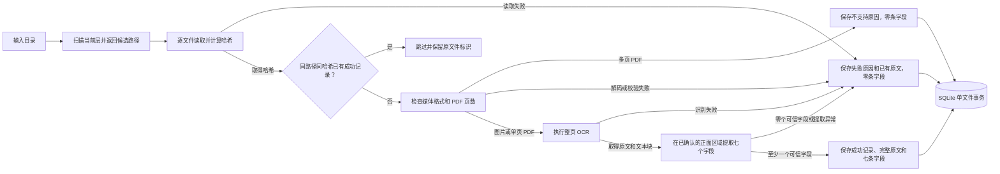
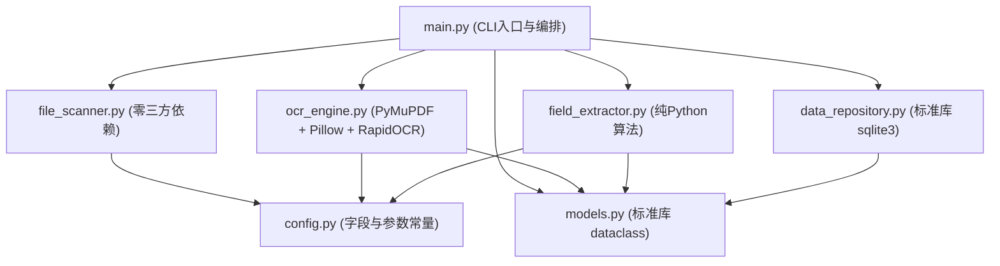

# 特种作业操作证 OCR 系统 — 第二阶段模块设计方案（V2.1）

**项目阶段**　第二阶段（架构设计与模块设计）

**文档状态**　架构审查修订稿。版面关系已对照两张原图核实，端到端结果待第三阶段验证。

**需求依据**　[需求分析说明书 V1.1](../prd.md)

**设计原则**　最小化设计、准确度优先、文件可追溯、单文件异常隔离。

---

## 一、设计背景与核心问题分析

### 1.1 任务边界

处理指定文件夹当前层的 PNG、JPG/JPEG 和单页 PDF，目标证件为**中华人民共和国特种作业操作证**。每份文件保留在原位置，可按 `file_id` 查回源文件路径和处理状态。成功记录关联整页 OCR 原文和固定七个字段，失败记录保留已取得的原文。其余功能边界沿用需求说明书第六节。

### 1.2 两类目标模板图片的真实版面差异与共性

两张样本分别来自横版打印页和竖版查询页。[横版原图](../证件模板/模板1.png) · [竖版原图](../证件模板/模板2.jpg)

| 对比维度 | `模板1.png`（官网导出横版打印页） | `模板2.jpg`（手机查询页竖版截图） |
|---|---|---|
| **分辨率** | `1679 × 1127` px | `1240 × 2772` px |
| **正反卡排布** | 正面卡（左）与背面卡（右）**左右并排** | 正面卡（上）与背面卡（下）**上下堆叠** |
| **正面卡占比与字号** | 卡片仅占约 `470 × 300` px，灰色小字标签高仅 `9~11` px | 卡片占约 `1050 × 600` px，灰色小字标签高约 `22` px |
| **标签和值** | 小字标签在上，字段值在其下方 | 同样以标签引出下方字段值 |
| **折行特征** | `操作项目` 分为两行，第二行只有“作业” | `操作项目` 单行，卡外红色备注跨两行 |
| **主要干扰源** | 页眉档案编码、右侧背面、卡下复审备注、页底声明 | 手机状态栏、有效/无效证书页签、下方背面、复审备注、主办/承办单位、备案号 |

两张图共用下表的卡内关系。第一行和第二行指同一区域内的字段行，每个字段的标签与值通常另起一行。

| 正面卡内区域 | 第一行左 / 右 | 第二行左 / 右 |
|---|---|---|
| 人像右侧 | 姓名 / 作业类别 | 性别 / 操作项目 |
| 卡片底部 | 初领日期 / 有效期限 | 应复审日期 / 签发机关 |

人像右侧与卡片底部的列起点不同。整页 OCR 一次，两类版式共用一个提取器。提取器依据各区域自己的同行、同列关系寻找字段，按文字框的实际行高适应缩放。证号位于人像右侧区域上方，应复审日期用于区分底部两行。

---

## 二、总体架构与模块划分

### 2.1 数据流架构



### 2.2 模块依赖关系（无环 DAG）

四个业务模块分别负责扫描、OCR、字段提取与持久化。`main.py` 编排它们，`config.py` 和 `models.py` 提供常量及数据契约。



---

## 三、各模块详细设计

### 3.1 数据契约模块（`models.py`）

| 契约 | 内容及使用边界 |
|---|---|
| `FileInfo` | 文件名、规范化绝对路径、小写扩展名和可空的 `file_hash`。主流程取得文件内容后填写 SHA-256，读取失败时仍可用路径登记失败。 |
| `TextBlock` | 文字、识别置信度和轴对齐包围框。坐标统一回到纠正方向后的整页图像，原点在左上角，向右和向下为正方向。 |
| `OCRResult` | OCR 状态、文本块、图像宽高、整页原文 `raw_text` 和错误原因。`ok` 表示已取得有效文本块，另两种状态为 `unsupported` 和 `failed`。 |
| 固定字段字典 | 固定七个键，每个值为文字或 `None`。提取器仅对已确认的正面区域赋值，主流程可直接按非空字段数判定提取结果。 |

### 3.2 最小化配置模块（`config.py`）

集中保存四种扩展名、单页 PDF 的 250 DPI 渲染分辨率、正式 OCR 参数（见 4.1）和下表的固定键及标签。几何匹配规则属于提取器内部逻辑。

| 标准键 | 可识别标签 | 字段规则 |
|---|---|---|
| 姓名 | 姓名 | 取本栏中文姓名，允许间隔号。 |
| 性别 | 性别 | 只接受单个“男”或“女”。 |
| 作业类别 | 作业类别、作业类型 | 取本栏完整的作业类别名称。 |
| 操作项目 | 操作项目、操作类型 | 可接续同栏下一行，保留原有标点。 |
| 初领日期 | 初领日期、初次领取日期 | 底部第一行左栏的单个合法日期。 |
| 签发机关 | 签发机关、发证机关 | 取本栏完整机构名称，允许换行。 |
| 有效期截止日期 | 有效期限、有效期、有效期至 | 区间取右端。只有明确的“有效期至”标签可以直接配单个日期。 |

“证号”“应复审日期”“复审日期”只辅助定位。“档案编码”、证书页签、复审备注及主办/承办单位属于整页原文，均排除在正面定位证据之外。

### 3.3 文件扫描模块（`file_scanner.py`）

`scan_folder` 接收目录，返回按文件名排序的候选文件绝对路径。只枚举当前层，按小写扩展名筛选 `.pdf`、`.png`、`.jpg`、`.jpeg`，跳过子目录。空目录返回空列表，目录本身无法枚举时报告批次错误。文件内容的读取和哈希计算归入主流程的单文件处理范围。

### 3.4 OCR 识别模块（`ocr_engine.py`）

`OCREngine.recognize` 接收单个文件的扩展名和已读取的内容，返回 `OCRResult`。同一份内容用于计算哈希和解码，批次内复用一个 OCR 引擎。

| 输入 | 处理与输出 |
|---|---|
| PNG、JPG/JPEG | 使用 Pillow 从内存解码并校正 EXIF 方向，将 Pillow 的 RGB 图像对象交给 RapidOCR。引擎直接接收图像，支持从 Windows 中文路径读入的文件。 |
| PDF | 使用 PyMuPDF 在内存中检查页数。多于一页直接返回 `unsupported`，跳过渲染和 OCR。零页、损坏或无法解密时返回 `failed`。单页以 250 DPI 渲染为同一类型的 Pillow RGB 图像。 |
| 整页图像 | 执行一次 OCR，保留所有有效文本块，在行内从左到右、行间从上到下拼接整页原文。若有效文本块为零（含空白单页），返回 `failed` 和原因。 |

页眉、背面和页脚识别到的文字也进入 `raw_text`，用于按文件标识回查。字段匹配直接使用带坐标的文本块。

### 3.5 字段提取模块（`field_extractor.py`）

`extract_fields` 接收文本块列表和整页图像宽高，返回 3.2 的七键字典。提取在内存完成，两个模板共用以下规则。

#### 3.5.1 确认正面局部区域

匹配前忽略标签中的空格和尾部冒号。“姓名”“性别”“证号”等短标签要求精确匹配。长标签接受 3.2 所列别名和样本评测中已观察到的错字，例如“初领目期”可匹配“初领日期”。

在同一区域寻找**两个不同字段**，其相对位置须符合 1.2 表格。例如“姓名”与“作业类别”同排左右相邻，或“有效期限”与“签发机关”在底部右栏上下相邻。以 T 开头、后接 18 位身份号码（末位可为 X）的证号可辅助确认其下方的人像右侧区域，完整有效期区间可辅助确认底部区域。同一字段的标签和值只算一项证据。同行通过文字框的垂直重叠和该处行高判断，同列通过文字框左边缘对齐判断。

两个区域分别确认。只有一组可定位时，仍可提取该组内的可信字段。两个孤立词、两处相距很远的匹配或同一行的一对标签，都不足以外推整张卡片的边界。

#### 3.5.2 在所属行列内组装字段值

1. 值通常紧接标签下方。若标签和值粘在同块中，先分离标签前缀，再把剩余文字与本栏碎块一起处理。
2. 左右分界优先采用本行相邻标签，某一列标签漏检时借用**本区域另一行**已确认的列起点。最右栏从其列起点收取下方对齐的值，直到出现明显文字间隔或其他区域。同列下一标签限定向下取值范围。列界不明、候选跨栏或存在多个合理值时，该字段留空。
3. 同一字段内先按行聚合，再从左到右连接同行碎块。“操作项目”和“签发机关”可继续接上本栏紧邻且左对齐的下一行，遇到新标签或区域边界即停止。横版的“高处安装、维护、拆除”和下一行“作业”据此组成一个字段值。

#### 3.5.3 标签缺失与日期判定

| 字段 | 允许采用的证据 |
|---|---|
| 性别、签发机关 | 标签漏检时，仅在人像右侧区域第二行左栏取唯一的“男”或“女”，或在底部第二行右栏取唯一、完整且可辨认的机关名称（如以“应急管理局”结尾）。 |
| 初领日期 | 底部第一行左栏。标签漏检时，要求候选与有效期区间**同一行、位于其左侧**，且为唯一合法单日期。下一行应复审日期及卡外备注另有用途。 |
| 有效期截止日期 | 先合并本栏同行碎块，识别两个完整合法的日期及其间的“至”或区间横线，取右端日期。“有效期限”或“有效期”下只有起日、区间残缺或日期非法时留空。仅在明确的“有效期至”标签下，单个合法日期可直接使用。 |
| 姓名、作业类别、操作项目 | 由本字段标签及本栏文字确定。仅凭一个姓名样式或含“作业”的词，无法区分归属时留空。 |

日期用日历规则校验，统一输出 `YYYY-MM-DD`。竖版样本的初领日期为 `2019-03-06`，有效期限为 `2022-08-29至2028-08-28`，应复审日期为 `2025-08-28`。要写入的两个日期分别为 `2019-03-06` 和 `2028-08-28`。

### 3.6 数据持久化模块（`data_repository.py`）

使用标准库 `sqlite3`，每个连接启用外键。每份处理结果在一个事务中提交。

| 实体 | 内容与约束 |
|---|---|
| `files` | `file_id` 为 UUID4 主键，记录 `file_name`、绝对路径 `file_path`、`status`、`error_message` 和 ISO 8601 格式的 `created_at`。只在未取得文件内容时允许 `file_hash` 为空。只要已取得原文就保存 `raw_text`。以路径与哈希的组合索引查找成功记录。 |
| `extracted_fields` | `id` 为自增主键，`file_id` 为关联文件记录的外键，随该记录级联删除。每个文件的 `field_key` 唯一，`field_value` 可为空。成功记录写齐七行，其中未确定的值存 `NULL`。 |

| 仓储操作 | 事务契约 |
|---|---|
| `find_existing_success_id` | 输入绝对路径和已取得的哈希，只查询成功记录。命中返回原 `file_id`。 |
| `save_success` | 单事务保存文件、完整原文和七条字段。前提为至少一个字段可信。返回本次保存的 `file_id`。 |
| `save_non_success` | 保存文件信息、`failed` 或 `unsupported`、具体原因及可用原文，关联字段为零行。 |
| `query_by_file_id` | 通过同一标识返回文件信息、原文和关联字段。失败及不支持的记录也可查询，其字段集合为空。 |

### 3.7 主流程编排模块（`main.py`）

正式命令接收必填输入目录 `--input` 和可选数据库路径 `--db`（默认 `./data/ocr.db`），固定使用高精度组合。快速档仅用于独立测试库的开发联调。否则同一文件在快速档产生的成功记录会使正式识别被跳过。

1. 校验输入目录，取得候选路径并准备数据库。逐文件读取内容、计算 SHA-256。文件消失、被占用等读取错误记为 `failed`，保留路径、空哈希和原因，继续下一文件。
2. 若同路径、同哈希已有成功记录，跳过处理并保留原 `file_id`。其他情况进入 OCR，包括此前处理失败的文件。同名但路径不同的文件以及同路径内容有变的文件分别登记。
3. OCR 返回 `unsupported` 或 `failed` 时，保存相应状态和原因。返回 `ok` 时，将文本块和图像尺寸交给提取器。
4. 至少一个字段在已确认的正面区域内取得可信值，保存 `success`、整页原文和七个键。零个可信字段或提取发生异常时，保存 `failed`、已有原文和原因，字段零行。
5. 文件级错误登记后继续处理。数据库查询或写入失败属于批次错误，回滚未提交的事务，报告故障并以非零状态结束。已提交的文件结果仍可查询。批次统计分别列出扫描总数、成功、跳过、不支持和失败，处理结果按已提交事务计数。

---

## 四、OCR 技术选型与已有评测

### 4.1 选定 OCR 推理架构规格

正式流程采用 RapidOCR 3 系列与 ONNX Runtime 的 CPU 后端，本地加载下列模型。

| 项目 | 设计取值 |
|---|---|
| 检测模型 | `ch_PP-OCRv4_det_mobile.onnx`（4.53 MB） |
| 正式识别模型 | `ch_PP-OCRv5_rec_server.onnx`（80.66 MB） |
| 开发联调识别模型 | `ch_PP-OCRv4_rec_mobile.onnx`（10.35 MB），仅用于独立测试库 |
| 图像尺寸 | 全局长边上限 `Global.max_side_len=2800`，检测使用长边模式 `Det.limit_type=max` 和 `Det.limit_side_len=2400`。 |

历史记录只注明 RapidOCR 3 系列和部分限长参数。第三阶段须核实实际生效的长边模式，固定通过两张原图验收的 RapidOCR、ONNX Runtime 小版本，并记录模型文件名和生效参数。两种媒体入口统一传入 Pillow RGB 图像，以使用引擎针对该类型的颜色通道转换。[RapidOCR 参数说明](https://rapidai.github.io/RapidOCRDocs/main/install_usage/rapidocr/parameters/#det) · [图像输入处理](https://github.com/RapidAI/RapidOCR/blob/main/python/rapidocr/utils/load_image.py#L137)

### 4.2 已有模型对比记录

下表沿用 V2.0 在 Windows、Intel Core i7-9750H、Python 3.12、`uv` 环境记录的数据。退化样本由原图缩放至 `0.65×`、按 JPEG 质量 `Q55` 编码得到。命中数按各次评测选取的标签或值文本块统计，横版的操作项目分成两个值块。`avg` 为平均置信度。高精度组合的既有单图耗时中，检测约 2～3 秒，识别约 33～38 秒。最终字段的归属和拼接结果按第七节逐项核验。

| 候选方案 | 模板1 原图 | 模板2 原图 | 模板1 模拟压缩 | 模板2 模拟压缩 | 单图 CPU 耗时 | 选型依据 |
|---|---|---|---|---|---|---|
| **方案 1，高精度**　PP-OCRv4 Mobile Det（限长 2400）＋ PP-OCRv5 Server Rec | 标签 **7/7**、值 **8/8**（`avg=0.997`） | 标签 **7/7**、值 **7/7**（`avg=0.993`） | 标签 2/7、值 7/8，日期、机关及操作项目文字识别正确 | 标签 **7/7**、值 **7/7**（`avg=0.989`） | 35～41 秒 | 选作正式组合。清晰原图的目标文字全部命中。 |
| 方案 2，快速联调　PP-OCRv4 Mobile Det ＋ PP-OCRv4 Mobile Rec | 标签 7/7、值 8/8（`avg=0.992`） | 标签 7/7、值 7/7（`avg=0.991`） | 标签 0/7、值 7/8 | 标签 6/7（“初日期”漏字）、值 7/7 | 2.7～6.8 秒 | 联调耗时短，压缩横版标签漏检较多。 |
| 方案 3　PP-OCRv5 Mobile Det ＋ PP-OCRv5 Mobile Rec（限长 2800） | 备注丢字、边框误检 | 标签 6/7，“初领日期”误识为“初领目期” | 误识率偏高 | 存在字符误识 | 2.8～3.0 秒 | 小字出现形近字误识。 |
| 方案 4　PP-OCRv5 Mobile Det ＋ PP-OCRv5 Server Rec（限长 2400） | 标签 7/7、值 8/8（`avg=0.977`） | 值 6/7，“登高架设作业”漏“高” | 出现 `2031-55-12` 与“男男” | 标签 7/7、值 7/7 | 26～36 秒 | 原评测观察到检测框偏移。 |
| 方案 5　PP-OCRv4 Mobile Det ＋ PP-OCRv4 Server Rec | 标签 7/7、值 8/8（`avg=0.996`） | 标签 7/7、值 7/7（`avg=0.990`） | 值 8/8 | 标签 7/7、值 7/7 | 130～159 秒 | 压缩横版值块全部命中，单图耗时较长。 |
| 方案 6　PP-OCRv5 Server Det ＋ PP-OCRv5 Server Rec（限长 2800 / 1280） | 限长 2800 时 9/9，限长 1280 时漏检“初领日期” | 标签 9/9、值 7/7 | 标签 2/7、值 7/8 | 标签 7/7、值 7/7 | 54～66 秒 | 检测模型约 84 MB，降低限长时漏检小字。 |

### 4.3 运行依赖

| 组件 | 技术选型 | 说明 |
|---|---|---|
| 编程语言与环境管理 | Python 3.11+ / `uv`（`pyproject.toml`） | 统一使用 `uv run` 执行 |
| OCR 引擎 | `rapidocr` + `onnxruntime` | 本地离线运行 PP-OCRv4 Det + PP-OCRv5 Server Rec |
| PDF 单页校验与渲染 | `PyMuPDF` (`fitz`) | 单库完成页数校验与 250 DPI 内存渲染 |
| 图片加载 | `Pillow` | 从内存解码、校正 EXIF 方向，提供统一的 RGB 图像 |
| 数据存储 | Python 标准库 `sqlite3` | 轻量单文件、外键与事务原生支持 |
| 日期解析 | Python 标准库 `re` + `datetime` | 严格日历校验，拒绝将干扰数字误判为日期 |

---

## 五、目录结构规划

```text
E:/D/zuoyewenjian/MyProject/ocr/
├── pyproject.toml           # uv 项目配置与最小核心依赖
├── main.py                  # 命令行入口、逐文件读取与哈希、状态编排
├── config.py                # 7 个固定字段配置与 OCR 参数常量
├── models.py                # 标准数据契约 (dataclass)
├── file_scanner.py          # 枚举当前层候选路径、过滤扩展名并排序
├── ocr_engine.py            # 媒体校验、整页识别、原文和文本框
├── field_extractor.py       # 确认卡内区域、按栏组装字段、校验日期
├── data_repository.py       # SQLite 事务持久化与查询
├── tests/                   # 自动化单元测试与集成测试
├── prd.md                   # 需求分析说明书（已存在）
├── plan/                    # 模块设计文档目录
│   └── prd-md-ocr-snug-cherny.md
├── 证件模板/                # 目标模板样本（已存在）
│   ├── 模板1.png
│   └── 模板2.jpg
└── data/                    # 运行时自动创建的数据库目录（默认 data/ocr.db）
```

---

## 六、异常处理与容错矩阵

| 场景 | 文件状态 | 内容哈希 | 整页原文 | 字段行 | 后续处理 |
|---|---|---|---|---|---|
| 正面区域已确认且至少一个字段可信 | `success` | 已取得 | 保存 | 七行，缺项存 `NULL` | 提交事务，继续 |
| 同路径同哈希已有成功记录 | 跳过，沿用成功记录 | 已取得 | 沿用 | 沿用原七行 | 保留原 `file_id` |
| 文件被占用或枚举后消失，无法读取 | `failed` | `NULL` | `NULL` | 零行 | 保存路径和原因，继续 |
| 多页 PDF | `unsupported` | 已取得 | `NULL` | 零行 | 跳过渲染及 OCR，继续 |
| 损坏图片、损坏或零页 PDF、无法解密的 PDF | `failed` | 已取得 | `NULL` | 零行 | 保存原因，继续 |
| 空白图、空白单页或未识别到有效文字 | `failed` | 已取得 | `NULL` | 零行 | 保存原因，继续 |
| 只读到页眉、背面或页脚，或七个目标字段均无法确定 | `failed` | 已取得 | 保存已识别原文 | 零行 | 保存提取失败原因，继续 |
| 已取得原文，后续字段提取发生异常 | `failed` | 已取得 | 保存已识别原文 | 零行 | 保存异常原因，继续 |
| 数据库不可用或事务提交失败 | 批次故障 | — | — | 回滚当前事务 | 报告批次错误并结束，保留此前已提交记录 |

## 七、验证与验收方案

### 7.1 模块验证

| 验证对象 | 用例及期望 |
|---|---|
| 扫描与读取 | 大小写扩展名均可匹配，子目录与其他格式跳过，空目录返回空列表。模拟某候选文件在读取时被占用或消失，该路径有失败记录且哈希为空，下一份正常文件仍被处理。 |
| 位置与归属 | 将两张样本的文本框分别整体平移、等比缩放，七项输出应与原样本相同。去掉同行右侧标签时，只能借本区域另一行确定列界。再移除可借用的证据，无法归属的字段应为空，已确定的字段仍取原值。 |
| 卡外干扰与错字 | 页眉“档案编码”、背面文字、红色备注、页脚主办单位均可进入原文。仅这些文字时提取结果七项全空。“初领目期”可按已知别名匹配，任意改动一个字的短标签不自动成为锚点。 |
| 折行与同行拆块 | 横版操作项目两行应合成“高处安装、维护、拆除作业”。竖版有效期拆成 `2022-08-29`、“至”、`2028-08-28` 三块后，截止日期应为 `2028-08-28`。删去截止端或改成非法日期，截止字段应为空。明确标签“有效期至”配单个合法日期时，应返回该日期。 |
| 初领日期标签漏检 | 移除竖版的“初领日期”标签，保留完整有效期区间、下一行复审日期和卡外红色备注。应取区间同排左侧的 `2019-03-06`。再移除该日期的值，初领日期应为空。 |
| 降级与状态 | 人像右侧、卡片底部各自验证一组可确认、另一组证据不足的情况。至少一项可信时写齐七行，零项可信时记录失败、保留已有原文且字段零行。 |
| 持久化与幂等 | 用 `file_id` 分别查回两个文件的路径、原文和字段，重开数据库后仍能查回。重复扫描未变更的成功文件保留原标识，失败文件可重试。验证外键、同文件字段键唯一，以及写字段中途失败时文件行和字段行一起回滚。 |

### 7.2 端到端验收

1. **两张原图**通过正式命令处理，按各自 `file_id` 查询数据库，并与下表逐项比对。验收目标为 **14/14 个最终字段值正确**。
2. **单页 PDF**分别由两张原图封装，各自的七个最终字段须与对应图片一致。将正常图、单页 PDF、双页 PDF、损坏图片、不可读文件、仅含背面的图混合处理，逐项核对第六节的状态、原文和字段行数。复跑时核对跳过数与失败重试行为。
3. **模拟压缩图**使用 4.2 的退化条件。逐图对七个键分别标记“正确、缺失、错填”，三项之和为七。若整份提取失败，七项计入缺失。允许证据不足的字段缺失，**错填目标为零**。对人工核实仍有唯一归属证据的字段，单独断言应恢复的值。
4. **批次故障**模拟数据库不可写，核对故障报告、非零退出状态和此前已提交的结果。

第三阶段运行自动化用例使用 `uv run --with pytest pytest`。人工核验入口为 `uv run main.py --input "./证件模板" --db "./data/ocr.db"`。

**两张清晰原图的逐字段验收基准**

| 标准键 | `模板1.png` 期望值 | `模板2.jpg` 期望值 |
|---|---|---|
| `姓名` | `廖浩庄` | `罗德财` |
| `性别` | `男` | `男` |
| `作业类别` | `高处作业` | `高处作业` |
| `操作项目` | `高处安装、维护、拆除作业` | `登高架设作业` |
| `初领日期` | `2025-05-13` | `2019-03-06` |
| `签发机关` | `惠州市应急管理局` | `东莞市应急管理局` |
| `有效期截止日期` | `2031-05-12` | `2028-08-28` |

---

## 八、第三阶段实施顺序

1. 确立数据契约、候选路径扫描与两表事务，验证同一文件的原文和字段可按标识查回。
2. 接入统一的图片与单页 PDF 识别入口，记录两张原图的文本块、模型版本与生效配置，核对小字标签、整页原文和坐标。
3. 用人工核对过的文本块验证两个局部区域的字段归属、拆块、折行和缺失，再接入真实 OCR 输出。
4. 串联逐文件处理，按第七节验证两张原图的 14 个值、压缩样本、混合批次、事务回滚及重复运行，覆盖需求说明书的六个最小验收场景。
